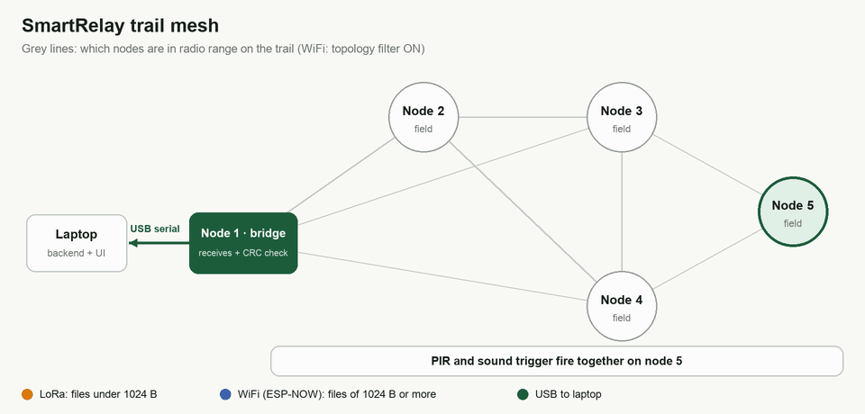
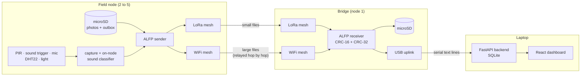
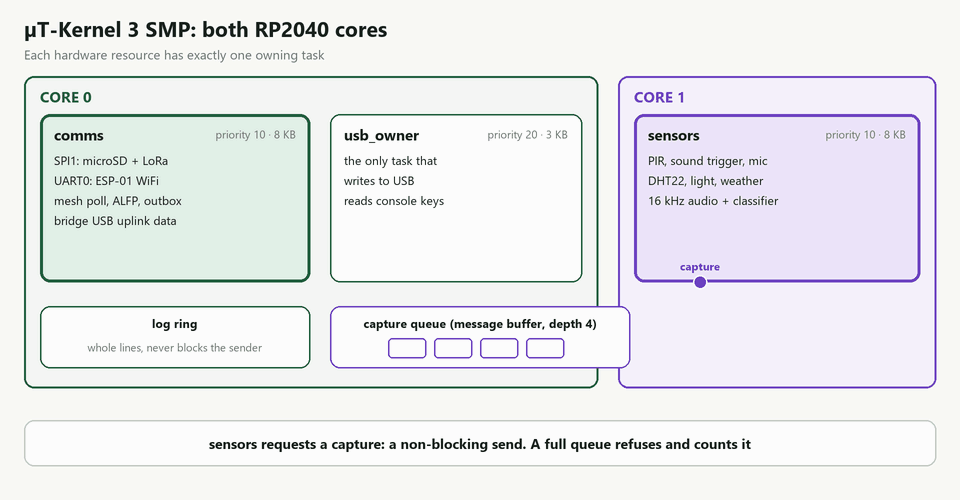
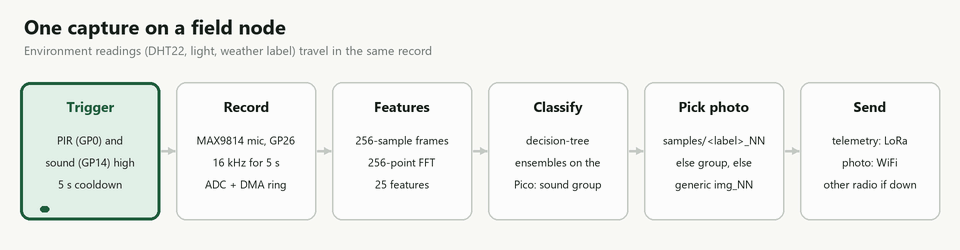
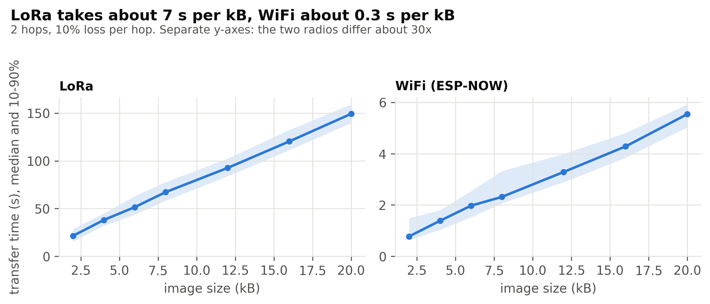
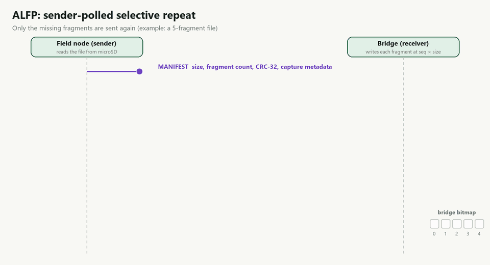
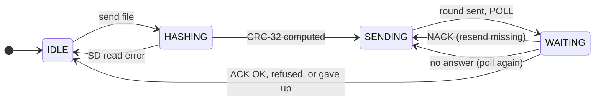
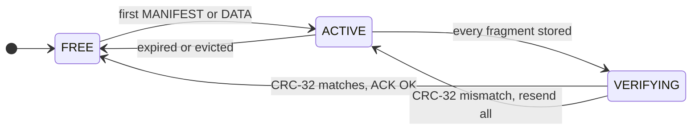
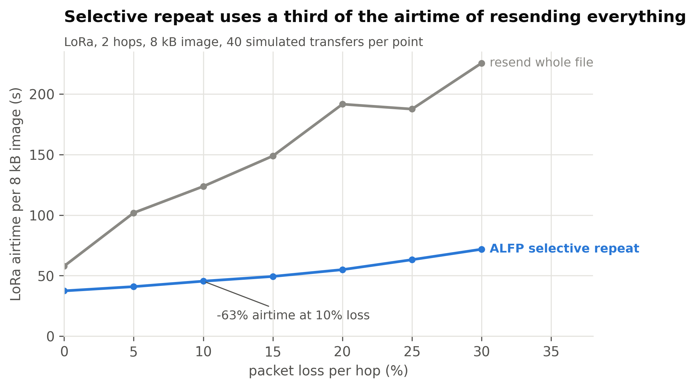
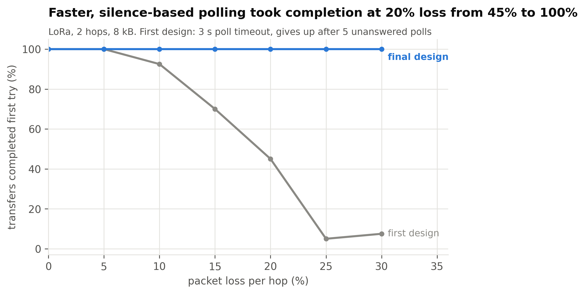

# SmartRelay

**A dual-radio, multi-hop sensor mesh for trail wildlife monitoring, on five Raspberry Pi Pico W nodes.**



[Overview](#overview) ·
[Architecture](#architecture) ·
[Dual-core microkernel](#dual-core-microkernel-tribunal-1) ·
[Radios](#radios-wifi-and-lora) ·
[ALFP](#alfp-the-file-transfer-protocol) ·
[Sensors](#sensors-and-on-node-classification) ·
[Dashboard](#dashboard) ·
[Run it](#build-flash-and-run) ·
[Testing](#testing-and-evidence) ·
[Coding standard](#coding-standard-barr-c2018)

---

## Overview

Four **field nodes** (2 to 5) watch a trail. When motion and sound are detected together, a node
records audio, classifies the sound on the chip, reads the environment sensors, and sends the result
with a photo to the **bridge** (node 1). The bridge verifies each file, stores it on microSD and
streams it over USB to a laptop, where a backend and web dashboard display it. Nodes that cannot
reach the bridge directly are relayed by their neighbours.

| | |
| --- | --- |
| Hardware | 5 × Raspberry Pi Pico W (RP2040) on Maker Pi Pico boards |
| Radios per node | LoRa (Core1121 / LR1121, 924.2 MHz) and WiFi (ESP-01S running ESP-NOW) |
| Storage | microSD (FatFs) on every node; SQLite on the laptop |
| Firmware | C. Two builds of the node: **µT-Kernel 3 SMP on both cores**, and FreeRTOS on one core |
| Laptop side | Python (FastAPI) backend, React + TypeScript dashboard |
| C style | [BARR-C:2018](#coding-standard-barr-c2018) |

### What is real, and what stands in

- **Real:** the PIR and sound triggers, the 5 s audio recording, the on-node classification, the
  DHT22 and light readings, both radio meshes, the file transfer and its integrity checks.
- **Stand-in:** there is no camera. The "photo" is a sample JPEG on the node's microSD card, chosen
  to match the sound that was heard.
- **Sound groups, not species:** the classifier reports a group such as bird, mammal or
  insect/frog. It is deliberately set never to name an animal
  ([why](docs/SENSORS.md#what-the-classifier-can-and-cannot-do)).

## Architecture



Each layer only knows the one below it:

| Layer | Code | Job |
| --- | --- | --- |
| Sensing | `firmware/sensing/`, `third_party/sensors/` | trigger, record, classify, read the environment |
| Transfer | `alfp/` | split files, verify, resend what is missing, queue on SD |
| Radio interface | `mesh/mesh_radio.h` | one set of function pointers that both radios implement |
| Meshes | `third_party/lora_mesh/`, `third_party/wifi_mesh/` | flooding with duplicate suppression and a hop limit |
| Node firmware | `firmware_smp/`, `firmware/` | tasks, hardware ownership, console, USB uplink |
| Laptop | `backend/`, `dashboard/` | re-verify, store, display |

Because both meshes implement the same `mesh_radio_t` interface, the transfer layer runs unchanged
over either radio, and the same protocol code also runs on a laptop inside a mesh simulator.

## Dual-core microkernel (Tribunal 1)

The Tribunal 1 requirement was a microkernel running on **both RP2040 cores, core 0 and core 1**.
SmartRelay's node firmware was ported from single-core FreeRTOS to **µT-Kernel 3 SMP**
(symmetric multiprocessing: one kernel scheduling tasks across both cores).



| Task | Core | Priority* | Stack | Owns |
| --- | --- | --- | --- | --- |
| `comms` | 0 | 10 | 8 KB | SPI1 (microSD **and** LoRa), UART0 (WiFi), meshes, ALFP, outbox, uplink |
| `usb_owner` | 0 | 20 | 3 KB | the USB console: the only task that writes to USB, and reads the keys |
| `sensors` | 1 | 10 | 8 KB | PIR, sound trigger, mic (ADC + DMA), DHT22, light, classifier |

\* In µT-Kernel a smaller number is a higher priority.

Design rules:

- **One owner per hardware resource.** The SD card and the LoRa radio share one SPI bus, and only
  `comms` ever touches it, so the mesh and file system code need no mutex.
- **Sensing has a core to itself,** so radio and SD work cannot disturb 16 kHz audio sampling.
- **Tasks never block each other.** Captures go through a 4-deep message buffer with a
  non-blocking send (a full queue refuses and counts it). All `printf` output goes into a log ring
  that `usb_owner` drains, so a stalled laptop terminal cannot freeze the node.
- **No kernel calls in interrupts.** This port has no interrupt-safe kernel calls, so the UART
  interrupt only fills a ring buffer under a spinlock; `comms` parses it later.
- **1 ms kernel tick,** with core 0 as the only timekeeper.

The kernel does not start the Pico SDK runtime, so the port also supplies clock reporting, the
1 MHz timer, interrupt registration, mutexes, sleeps, random numbers, the heap and `printf`.
**Full details, build steps, evidence and risks: [docs/MICROKERNEL.md](docs/MICROKERNEL.md).**

## Radios: WiFi and LoRa

Every node has two radios, forming **two separate flooding meshes**.

| | WiFi mesh | LoRa mesh |
| --- | --- | --- |
| Radio | ESP-01S ("WST") running ESP-NOW, over UART0 at 115200 baud | Core1121 (Semtech LR1121) on SPI1 |
| Settings | CRC-8 framed serial link to the module | 924.2 MHz (AS923), SF7, 125 kHz, CR 4/5, 14 dBm, CRC on |
| Mesh payload per packet | 245 bytes | 250 bytes |
| Hop limit | 4 | 4 |
| Random delay before relaying | 5 to 30 ms | 10 to 100 ms |
| Duplicate window | 30 s | 30 s |
| Bridge heartbeat | every 3 s | every 3 s |

Both put the same 5-byte header on a packet (`src`, `dst`, `pkt_id`, `hops`). Neither has
acknowledgements or retries: reliability is ALFP's job.

**Topology filter.** On a desk every radio hears every other radio, so no packet would ever need a
relay. The WiFi mesh can ignore packets from modules that would be out of range on a real trail:

| Node | Hears over WiFi (filter ON) |
| --- | --- |
| 1 (bridge) | 2, 3, 4 |
| 2 | 1, 3, 4 |
| 3 | 1, 2, 4, 5 |
| 4 | 1, 2, 3, 5 |
| 5 | 3, 4 (**must be relayed to reach node 1**) |

### Which radio carries a file



A capture is sent as **two files**: a small telemetry record and the photo.

| File | Radio | Why |
| --- | --- | --- |
| under 1024 B (telemetry) | **LoRa** first | tiny, and it keeps WiFi free for the photo |
| 1024 B or more (photo) | **WiFi** first | in simulation an 8 kB file takes 2.3 s on WiFi and 67 s on LoRa |

If the preferred radio has not heard the bridge within 10 s, the other one is used
(`reason=fallback` in the log). The choice is made **once per attempt**: a transfer never changes
radio halfway. If neither radio can reach the bridge, the job waits in the outbox on the SD card.



Packet formats and mesh behaviour: **[docs/PROTOCOLS.md](docs/PROTOCOLS.md)**.

## ALFP: the file transfer protocol

LoRa packets hold at most 255 bytes, and the photos are several kilobytes. **ALFP**
(Application-Layer Fragmentation Protocol) is this project's own protocol for moving a file
reliably over a lossy, multi-hop link.



| Packet | Direction | Purpose |
| --- | --- | --- |
| `MANIFEST` | sender → bridge | file size, fragment count and size, whole-file CRC-32, capture metadata |
| `DATA` | sender → bridge | one fragment with its sequence number |
| `POLL` | sender → bridge | "that is the round; what are you missing?" |
| `NACK` | bridge → sender | exactly the missing fragments, as a list or bitmap, whichever is shorter |
| `ACK` | bridge → sender | file complete and CRC-32 verified, or a refusal (`BUSY`, `STORAGE`, `TOO_BIG`) |

- **Selective repeat:** only lost fragments are sent again. At 10% loss per hop the simulator
  measured 63% less LoRa airtime than resending the whole file.
- **Two checks:** CRC-16 on every packet, CRC-32 on every file (checked by the bridge, then again
  by the laptop).
- **Streamed through SD:** fragments are written straight to the card at `seq × size`; the whole
  image is never held in RAM. All protocol state is statically allocated, with no `malloc`.
- **Store and forward:** unsent captures are job files in an on-card outbox (up to 64) that
  survives reboots and retries with backoff.
- **Limits:** up to 512 fragments, about 120 kB per file.

Sender and receiver state machines:





| Selective repeat against resend-all | How the design improved |
| --- | --- |
|  |  |

Design decisions with their evidence: **[docs/ALFP.md](docs/ALFP.md)**.

## Sensors and on-node classification

| Sensor | Pin | Used for |
| --- | --- | --- |
| PIR motion | GP0 | trigger |
| Sound trigger module (digital) | GP14 | trigger |
| MAX9814 microphone (analog) | GP26 / ADC0 | 5 s recording at 16 kHz |
| DHT22 | GP4 | temperature and humidity |
| Light module | GP27 / ADC1 | light level |
| Maker board button | GP20 | capture now |

1. **Trigger:** PIR and sound trigger high together, then a 5 s cooldown.
2. **Record:** the ADC samples at 16 kHz and DMA fills a 16 kB ring, so the 5 s clip never needs a
   160 kB buffer.
3. **Features:** each 256-sample frame goes through a fixed-point FFT; running statistics give
   **25 spectral features** that describe the shape of the sound rather than its loudness (the
   microphone has automatic gain control).
4. **Classify:** small decision-tree ensembles, trained on a laptop and exported to C, run on the
   Pico and pick a sound group.
5. **Weather:** a decision tree on temperature, humidity and light labels the capture `Cloudy`,
   `Hot_Dry` or `Humid_Rainy`.

On the held-out test fold the group classifier scores **49% group accuracy** over seven groups,
and **81% at telling animal from non-animal**, against 47% for the earlier threshold method. These
come from ESC-50 audio clips replayed to the node's microphone, not field recordings.
Details: **[docs/SENSORS.md](docs/SENSORS.md)** and the
[model card](docs/sound/model_card.md).

## Dashboard

The bridge writes text lines over USB. A FastAPI backend parses them, re-checks every file's
CRC-32, stores captures in SQLite and pushes updates to a React dashboard over a WebSocket.

| Page | Shows |
| --- | --- |
| Overview | recent captures, node activity and the mesh log |
| Captures | every capture, with its image, readings, radio and CRC status |
| Species | a tally of the sound labels reported by the nodes |
| Node | one node's captures and its temperature, humidity and light history |
| Review | placeholder: the review workflow is not built |

The FreeRTOS bridge also reports each transfer **while it is arriving** (`@EVT` lines: fragments,
relay, hops, NACK rounds). The backend stores and serves these
(`/api/transfers`); the dashboard in this repository does not draw them yet.

No hardware? `simulator/demo_feed.py` feeds the backend simulated captures, which are stored and
shown with a **simulated** badge. How to run it and the full API:
**[docs/DASHBOARD.md](docs/DASHBOARD.md)**.

## Build, flash and run

### Flash the ready-made images

Hold **BOOTSEL** on the Pico, plug it in, and drag a `.uf2` from `uf2/` onto the `RPI-RP2` drive.

| Images | What they are |
| --- | --- |
| `csc09_smp_node_1.uf2` … `_5.uf2` | **dual-core µT-Kernel 3 SMP** node firmware (node 1 = bridge) |
| `csc09_node_1.uf2` … `_5.uf2` | FreeRTOS node firmware, with live transfer events |
| `sensor_test.uf2` | sensors only |
| `alfp_selftest.uf2` | microSD and ALFP over an in-memory radio |
| `lora_photo_tx.uf2`, `lora_photo_rx.uf2` | two-Pico LoRa photo test |

> These images were rebuilt from the current source (Arm GNU Toolchain 14.2, Pico SDK 2.1.1). They
> have **not been run on the boards since the coding-standard rewrite**; see
> [what was verified instead](docs/CODING_STANDARD.md#verification).

Each field node's SD card needs the `sd_card/samples/` folder. Wiring and staged bring-up:
**[docs/BRINGUP.md](docs/BRINGUP.md)**.

### Build from source

```bash
./tools/fetch_deps.sh                      # Pico SDK 2.1.1, FreeRTOS kernel, FatFs, pinned
# paste the three export lines it prints, then:
cmake -S firmware -B build-fw && cmake --build build-fw -j4

git submodule update --init third_party/mtk3smp_rp2040
firmware_smp/buildglue/build_smp.sh        # dual-core images for all five nodes
```

### Run the backend and dashboard

```bash
pip install -r backend/requirements.txt
cd backend && uvicorn app:app --port 8000  # finds the bridge's USB port, or set SMARTRELAY_BRIDGE_PORT
```

```bash
cd dashboard && npm install && npm run dev # http://localhost:5173
```

```bash
python simulator/demo_feed.py --burst 5 --label-images sd_card/samples   # demo without hardware
```

### Console keys on a node

Open the node's USB serial port at 115200 baud.

| Key | Action | | Key | Action (dual-core build only) |
| --- | --- | --- | --- | --- |
| `c` | capture now | | `w` | check the fitted WiFi module matches the node |
| `e` | print sensor readings | | `k` | measure the 1 ms kernel tick |
| `s` | statistics (shows each task's core) | | `x` | fire 5 captures to fill the queue |
| `d` | toggle 30% injected packet loss | | `z` | stop reading USB for 5 s |
| `t` | toggle the WiFi topology filter | | `B` | reboot into BOOTSEL |
| `H` / `p` / `h` | hold queue / send test payload / help | | | |

## Testing and evidence

```bash
tools/run_all_tests.sh     # style check, host unit tests, mesh integration, backend and ML tests
```

| Level | What it proves |
| --- | --- |
| Host unit tests | packet formats, CRCs, loss, corruption, radio choice, outbox, uplink, classifier |
| Mesh integration | the real LoRa and WiFi mesh C code, as separate processes with 20% loss: the file arrives byte-for-byte identical, including E → C → A multi-hop |
| Simulator experiments | the timing values in the protocol (`docs/results/`, `docs/figures/`) |
| Hardware, 19 Nov | two nodes on the dual-core build: a 60-minute soak delivered 107 of 107 files |

The hardware results predate the live-transfer feature and the coding-standard rewrite. What was
and was not tested: **[docs/TESTING.md](docs/TESTING.md)**.

## Coding standard: BARR-C:2018

All project C code follows **BARR-C:2018**, with each exception documented and approved as the
standard's deviation procedure requires.

```bash
tools/check_style.sh       # clang-format layout + tools/check_barrc.py + warnings-as-errors
```

Rule-by-rule table, naming conventions, deviations and verification:
**[docs/CODING_STANDARD.md](docs/CODING_STANDARD.md)**.

## Repository layout

```text
alfp/            ALFP file transfer library (portable C)
mesh/            the shared radio interface
common/          capture metadata, sound labels, USB uplink format
firmware/        FreeRTOS node firmware, sensing, bench test programs
firmware_smp/    µT-Kernel 3 SMP dual-core firmware, RTOS port layer, build glue
third_party/     team radio and sensor modules, vendor drivers, kernel submodule
host/            laptop tests, mesh simulator, integration harness, experiments
backend/         FastAPI + SQLite service
dashboard/       React + TypeScript dashboard
simulator/       demo feed for the backend
ml/              sound classifier training and export to C
sd_card/         sample images and test payloads for the microSD cards
tools/           build, test, style and diagram scripts
uf2/             ready-to-flash firmware images
docs/            detailed documentation, results and evidence
```

## Documentation

| Document | Contents |
| --- | --- |
| [MICROKERNEL.md](docs/MICROKERNEL.md) | µT-Kernel 3 SMP port, dual-core design, evidence |
| [PROTOCOLS.md](docs/PROTOCOLS.md) | WiFi and LoRa meshes, serial link, capture record, USB uplink |
| [ALFP.md](docs/ALFP.md) | transfer protocol design and measurements |
| [SENSORS.md](docs/SENSORS.md) | sensors, trigger, audio features, classifier |
| [DASHBOARD.md](docs/DASHBOARD.md) | backend, API, dashboard, demo mode |
| [BRINGUP.md](docs/BRINGUP.md) | wiring, SD cards, flashing, staged tests, troubleshooting |
| [TESTING.md](docs/TESTING.md) | test suites, results and known gaps |
| [CODING_STANDARD.md](docs/CODING_STANDARD.md) | BARR-C:2018 compliance |

## Team

CSC09. Module owners as recorded in the source and bring-up notes:

| Member | Area |
| --- | --- |
| Shreya | ALFP, microSD storage, integration |
| Mridula | LoRa mesh |
| Goutham | WiFi mesh |
| Rhaylene | sound trigger, audio features, sound classifier |
| Maryam | PIR, DHT22, weather label |

## Third-party code and credits

- µT-Kernel 3 SMP port for RP2040, a community port rather than an official release:
  [provenance and licences](third_party/MTK3SMP_PROVENANCE.md).
- Semtech LR11xx driver and Waveshare GPIO/SPI helpers under `third_party/lora_mesh/src/`.
- FreeRTOS kernel, Raspberry Pi Pico SDK and carlk3's FatFs library, fetched by
  `tools/fetch_deps.sh`.
- Sample photos are CC0, public domain, CC BY or CC BY-SA:
  [image credits](docs/sound/IMAGE_CREDITS.md).
- Classifier training audio: ESC-50 (Piczak, 2015), CC BY-NC 3.0.
