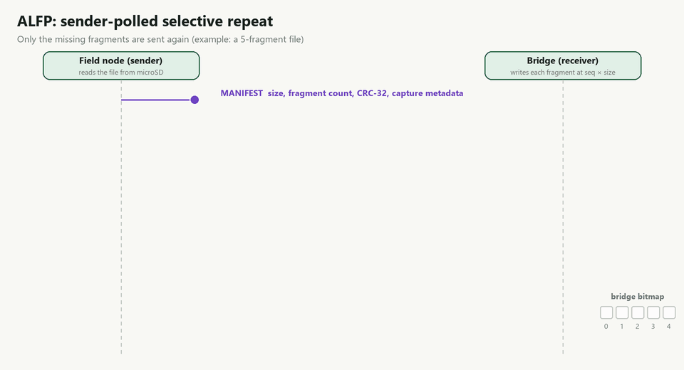

# ALFP: design notes

[Back to the README](../README.md) · [Packet formats](PROTOCOLS.md#5-alfp)

## What it does

A field node's capture (a sample image on its microSD card, standing in for a camera) is sent to
the bridge node (node 1) over one mesh radio, chosen once per transfer. The image is split into
fragments that fit the radio (241 bytes of image per LoRa packet, 236 per WiFi packet), every
fragment carries a sequence number and a CRC-16, the bridge writes each fragment straight to its SD
card and tracks which have arrived, and the sender resends only the missing ones. The whole file is
then checked with CRC-32 and handed to the laptop over USB.

## Protocol: sender-polled selective repeat

1. Sender computes the file's CRC-32 from the SD card (512 bytes per step, so the radio keeps being serviced).
2. MANIFEST: size, fragment count and size, CRC-32, radio, capture metadata (31-byte record).
3. DATA 0 .. n-1, paced (LoRa 500 ms after the radio goes idle; WiFi 10 ms).
4. POLL(round). Bridge answers with a NACK listing exactly the missing fragments (list or bitmap,
   whichever is shorter), or with ACK OK if everything is in and the CRC-32 matches.
5. Sender resends only those fragments (each twice if 4 or fewer remain) and polls again.
6. The bridge also sends ACK OK the moment the last fragment arrives and verifies.

Failure handling:

| Lost | What happens |
| --- | --- |
| MANIFEST | Bridge opens the session from DATA, NACK sets "manifest needed" |
| DATA | Listed in the next NACK |
| POLL or NACK | Sender polls again after 1.5 s (LoRa) / 0.2 s (WiFi) |
| ACK | Bridge remembers its last 8 finished transfers and ACKs again; no duplicate file |
| Bits corrupted after the radio CRC | CRC-16 rejects the packet; it is re-requested |
| File corrupted on the bridge SD | CRC-32 mismatch, ACK CRC_FAIL, whole file resent once |
| Bridge unreachable | Sender gives up after ~45 s (LoRa) / ~8 s (WiFi) of silence; job stays in `outbox/`, retried with 5-60 s backoff, oldest first |
| Sender vanishes | Bridge deletes the partial file after 60 s (LoRa) / 15 s (WiFi) idle |

## Packet formats (little-endian, CRC-16/CCITT-FALSE trailer on every packet)

| Type | Layout | Size |
| --- | --- | --- |
| MANIFEST 1 | b0, sid2, size4, count2, fsize2, crc32 4, radio1, metalen1, meta, crc2 | 19 + meta |
| DATA 2 | b0, sid2, seq2, count2, payload, crc2 | payload + 9 |
| POLL 3 | b0, sid2, round1, crc2 | 6 |
| NACK 4 | b0, sid2, flags1, round1, fmt1, body, crc2 (fmt: ALL, LIST n+seq2..., BITMAP base2 nbits2 bits, NONE) | 8 to ~80 |
| ACK 5 | b0, sid2, status1, crc2 (OK, CRC_FAIL, BUSY, STORAGE, TOO_BIG) | 6 |

b0 = version (high nibble, 1) | type (low nibble).

## Decisions and the evidence for them

| Decision | Evidence |
| --- | --- |
| Selective repeat, not resend-all | 63% less LoRa airtime at 10% loss per hop (45 s vs 124 s), 71% at 20% (docs/results/e4) |
| Selective repeat, not FEC (LoRaWAN TS004 style) | FEC suits one-way broadcast; we have a return path, so only real losses cost airtime |
| Sender polls; bridge never runs NACK timers | One owner of timing; no duplicate NACKs; lost NACK fixed by polling again |
| Fast polls + silence budget (not "5 tries") | First design completed 45% of transfers at 20% loss; final 100% (e2) |
| LoRa gap 500 ms | 2 hops: 4.0 transmissions per fragment with no gap, 1.8 at 500 ms. 700 ms is worse than both 500 and 1000. 1000 ms saves ~14% airtime at 3-4 hops (e1) |
| Adaptive pacing off | Built and measured: random loss makes it slow down for nothing (88 s vs 65 s median) |
| Tail duplication (<= 4 missing) | About one round fewer at the end of a transfer |
| CRC-16 per packet + CRC-32 per file | CRC-16/CCITT keeps Hamming distance 4 up to 32,751 bits (Koopman): catches all 1-3 bit errors in a 2,000-bit fragment; tested on every 1- and many 2-bit flips |
| Stream through SD, never buffer the image | ALFP state is 2.4 kB RAM total |
| One task owns radios + SD | FatFs built non-reentrant; mesh code needs no locks |
| Radio chosen once per attempt | WiFi if bridge heartbeat heard on WiFi within 10 s, else LoRa, else wait on SD |

## Radio choice by size

The requirement: small data (sensor readings, the sound label/features) goes over
LoRa; large data (images) goes over WiFi. `alfp_select_radio()` (above: "Radio chosen once per
attempt") never looked at size at all, just preference order and freshness -- a capture always
tried WiFi first regardless of how small it was. `alfp_select_radio_for_size()`
(`alfp/src/alfp_profiles.c`) adds that: below `APP_RADIO_SIZE_THRESHOLD` bytes it prefers LoRa and
falls back to WiFi if LoRa's bridge entry is not fresh; at or above it, the reverse. Either
fallback only fires on staleness, never mid-transfer (radio choice is still once per attempt, see
above): a job that cannot go on either radio stays queued on SD exactly as before. `alfp_select_radio()`
itself is unchanged, and `alfp_outbox_set_size_threshold(ob, 0)` turns the new rule back off.

**Threshold: 1,024 bytes.** From `docs/results/e6_size.csv`:

| Payload size | LoRa median | WiFi median |
| --- | --- | --- |
| 2,000 B | 21.4 s | 0.78 s |
| 8,000 B | 67.3 s | 2.3 s |
| 20,000 B | 149.3 s | 5.5 s |

(every row measured: `docs/results/e6_size.csv`, 40 trials each, 100% success)

Even the smallest size this table measures (2,000 B) already costs 21 s over LoRa against under a
second over WiFi -- the "prefer LoRa below the threshold" side of the rule is not about LoRa being
fast, it is about keeping WiFi free for the image while a telemetry-sized payload's extra latency
is tolerable and does not need the faster radio. The 27-byte capture record (`capture_meta_t`)
plus the small name-tail telemetry transfers actually send are two orders of
magnitude under even the cheapest row in this table, so 1,024 B comfortably separates "telemetry"
from "image" for every image this firmware has ever produced (`sd_card/samples/*.jpg` run
roughly 5.8-10.2 kB) while leaving room to grow. If a future sensor payload needs more than 1 KB,
raise the constant; nothing else needs to change.

**Maximum file size per radio**, from `ALFP_MAX_FRAGS` (512) and `ALFP_MAX_PKT` (250) in
`alfp/include/alfp_config.h`, and `ALFP_DATA_OVERHEAD` (9) in `alfp/include/alfp_wire.h`:

| Radio | Fragment payload | Max file size |
| --- | --- | --- |
| LoRa | 250 - 9 = 241 B | 241 x 512 = 123,392 B |
| WiFi | 245 - 9 = 236 B | 236 x 512 = 120,832 B |

`tools/make_test_payloads.py`'s size ladder stops at 120,832 B (the smaller of the two), so every
rung is sendable on whichever radio the size rule or a fallback picks.

**Telemetry and the image as two transfers.** One capture used to be one ALFP job (image path +
the 27-byte meta as the job's header). It is now two independent jobs sharing the same
`capture_id`: a tiny telemetry job (the packed meta record as its own "file", tagged with
`APP_TELEMETRY_MARKER` in the meta's filename-tail instead of an image name) and the image job
exactly as before. The size rule sends the telemetry job over LoRa and the image job over WiFi.
The backend links them by `capture_id` (`backend/storage.py`'s `record_capture()`), so a capture
with only its telemetry arrived (WiFi down) shows on the dashboard without an image, and the image
attaches to the same row whenever it arrives. `APP_SPLIT_TELEMETRY=0` restores the single combined
transfer the firmware sent originally.

## Measured performance (simulator, 8 kB image, 2 hops, 10% loss per hop)

| | LoRa | WiFi |
| --- | --- | --- |
| Median transfer time | 67 s | 2.3 s |
| Transmissions per fragment | 1.84 | 1.52 |
| First-attempt success up to 30% loss/hop (1-2 hops) | 100% | 100% |

Recommendation for the LoRa mesh: channel activity detection (listen-before-talk) before each
transmission makes transfers 18% faster (e3). The bridge's 3 s heartbeat is the main source of
collisions at 1 hop without it.

## Memory (arm-none-eabi, Pico W, measured on an earlier build)

| | Size |
| --- | --- |
| ALFP context | 2,452 B RAM |
| ALFP code | ~9 kB flash (+1.5 kB CRC tables) |
| Whole node firmware, all members' code | 178 kB flash, 110 kB static RAM of 264 kB (48 kB FreeRTOS heap, 16 kB audio DMA ring) |
