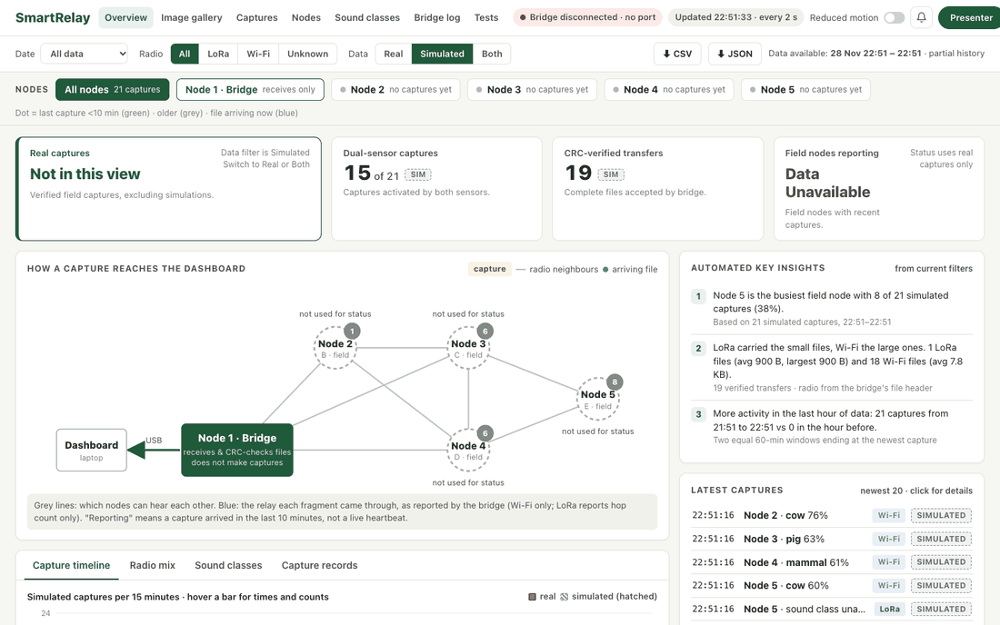
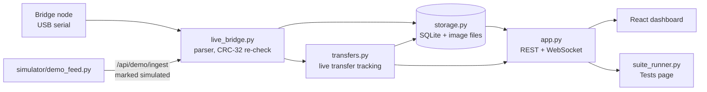
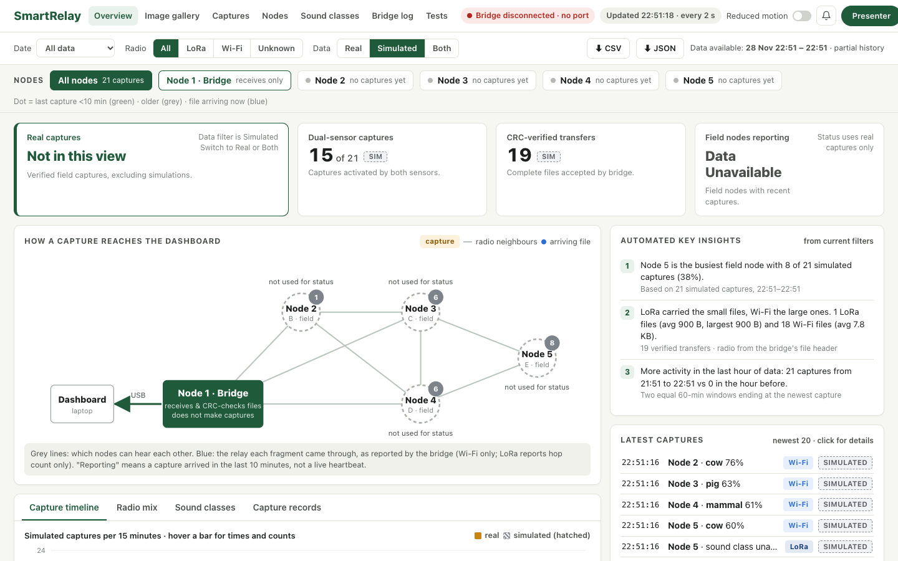
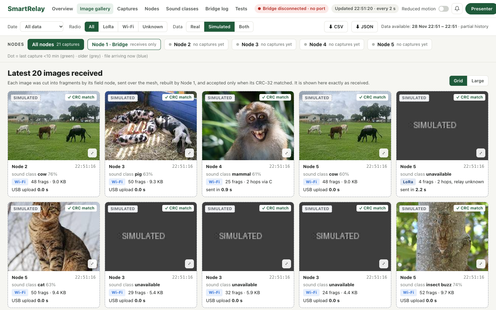
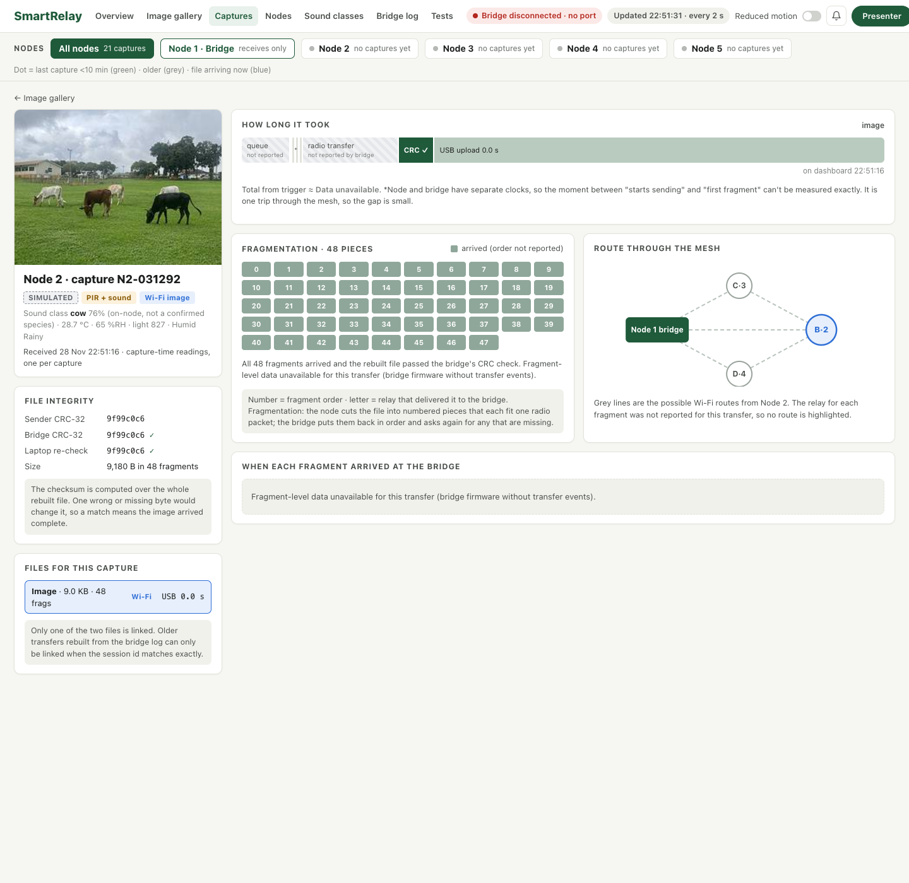
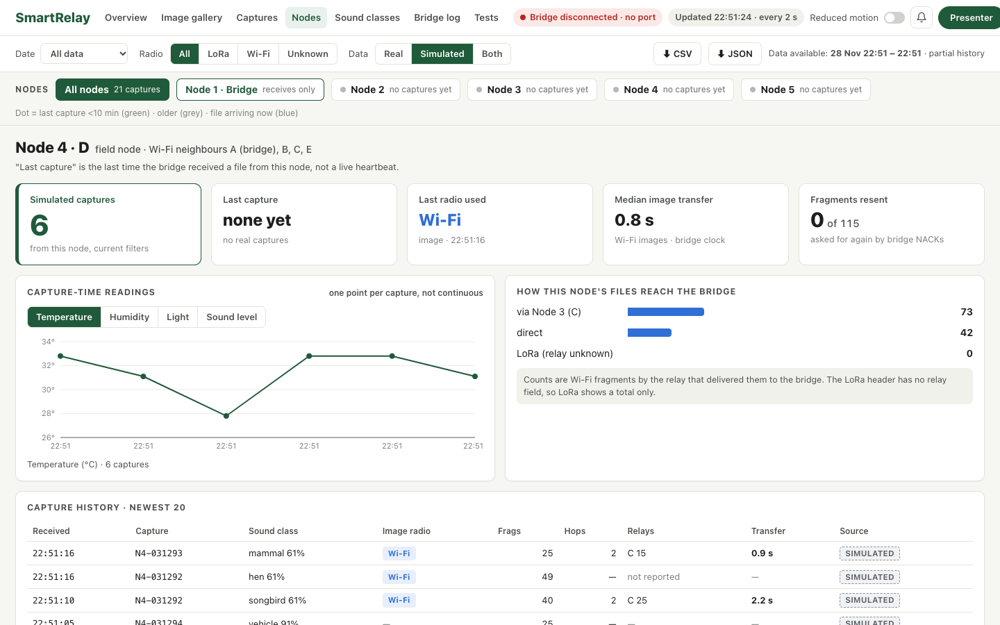
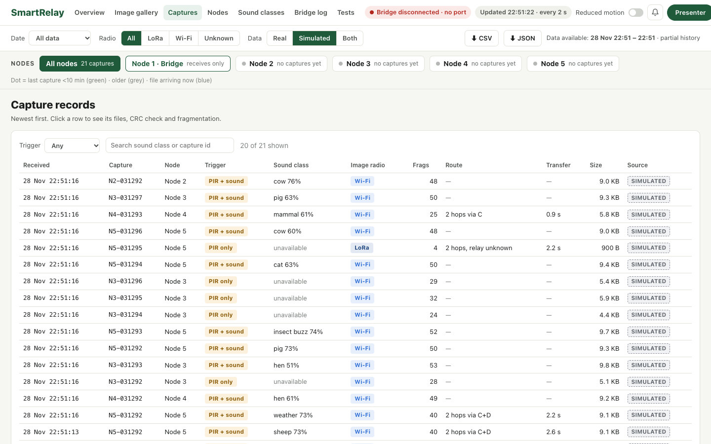
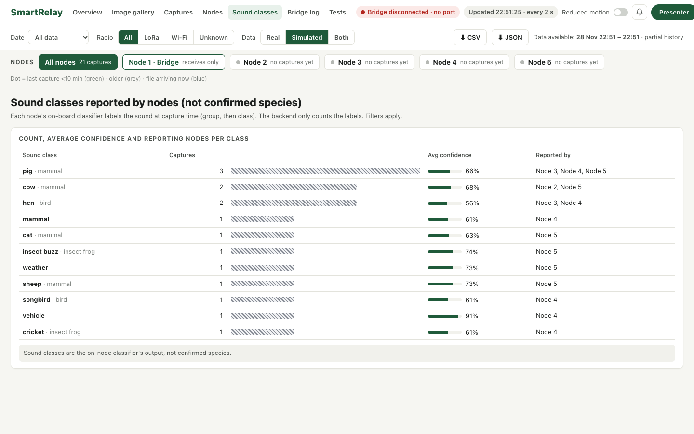
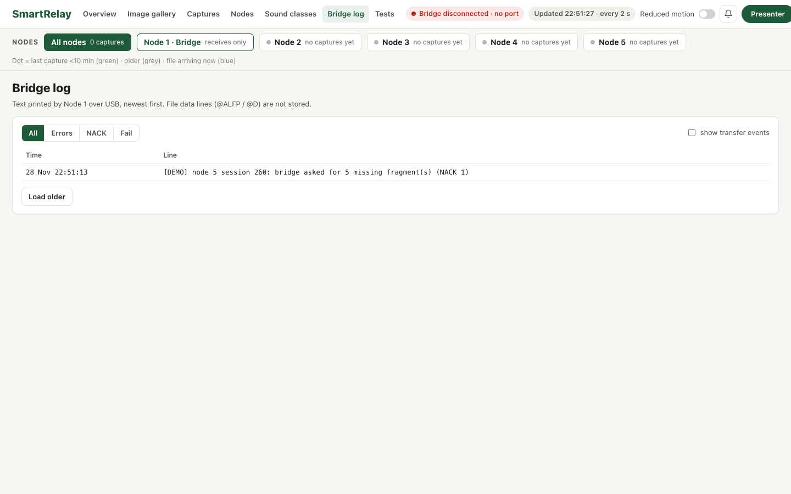
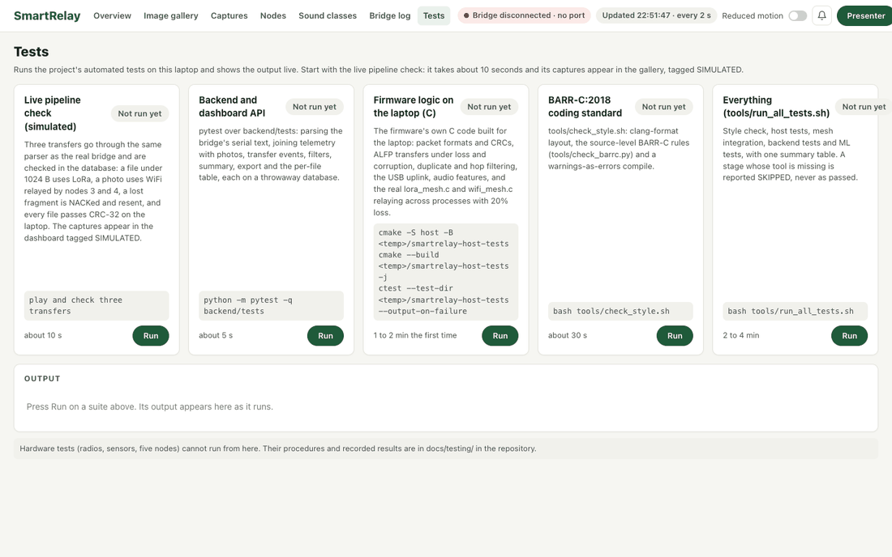

# Backend and dashboard

[Back to the README](../README.md)



*Simulated data, labelled SIMULATED on every card. Generated by `tools/dashboard_media.py`.*



## Run it

```bash
pip install -r backend/requirements.txt
cd dashboard && npm install && npm run build && cd ..
cd backend
uvicorn app:app --port 8000          # then open http://127.0.0.1:8000
```

The backend serves the built dashboard on port 8000. While changing the dashboard, run
`npm run dev` in `dashboard/` instead and open http://127.0.0.1:5173; it forwards `/api`, `/captures`
and `/ws` to the backend.

The backend looks for a Raspberry Pi serial device. With several Picos plugged in it can pick the
wrong one, so name the bridge's port:

```bash
SMARTRELAY_BRIDGE_PORT=/dev/cu.usbmodem101 uvicorn app:app --port 8000      # macOS / Linux
```
```powershell
$env:SMARTRELAY_BRIDGE_PORT = "COM5"; uvicorn app:app --port 8000          # Windows
```

Nothing else may hold that port, such as a serial monitor. The header shows **Bridge USB connected**
once it is open.

## Pages

| Page | Route | What it shows |
| --- | --- | --- |
| Overview | `/` | headline numbers, the mesh with files arriving live, automated insights, latest captures, timeline, radio mix and sound classes |
| Image gallery | `/gallery` | the latest 20 photos, each with its radio, fragments, hops and CRC result |
| Captures | `/captures` | every capture as a table; open one for its detail page |
| Capture detail | `/capture/{id}` | the photo and readings, file integrity (sender, bridge and laptop CRC-32), how long each stage took, every fragment with the relay that delivered it, the route through the mesh and when each fragment arrived |
| Nodes | `/nodes/{1-5}` | per node: captures, last radio, median transfer time, resends, readings over time and which relays carried its files. Node 1 is the bridge: USB link history, files in flight, recent log |
| Sound classes | `/sounds` | how often each class was reported, by node; these are the nodes' own classifications, not confirmed species |
| Bridge log | `/log` | the bridge's console lines, newest first, filterable to errors, NACKs or failures |
| Tests | `/tests` | runs the project's automated tests and shows the output live (below) |

| | |
| --- | --- |
|  |  |
|  |  |
|  |  |
|  | |

**Filters.** The bar under the header filters every number, chart and table by date, radio, data
source (Real, Simulated or Both) and node, and is kept in the URL so a filtered view can be shared or
bookmarked. **CSV** and **JSON** export the filtered captures with both files' transfer details.

**Live updates.** Every panel polls the REST API every 2 s; the WebSocket pushes new captures and
transfer events in between so they appear at once. The header shows when the page last updated and
turns amber after 10 s without an update.

**Presenter** opens a full-screen view of the latest capture for a projector, with a dark option.
**Reduced motion** stops the animations.

### Real and simulated data

Every row from `simulator/demo_feed.py` is stored with `is_demo = 1`, carries a SIMULATED badge and is
never counted as a real capture. The **Data** filter defaults to Real. Node status ("reporting") uses
real captures only, because the firmware sends the laptop no per-node heartbeat: a node counts as
reporting when a real capture from it arrived in the last 10 minutes.

### Which firmware fills which panel

The bridge reports each finished file in its `@ALFP FILE` header (radio, size, fragments, duplicates,
bridge CRC) and then streams the file, which the laptop re-checks. The **FreeRTOS** images
(`uf2/csc09_node_N.uf2`) also print `@EVT` lines while a file is arriving: each fragment, the relay
that delivered it, hop count, NACK rounds and timing. With the **dual-core** images
(`csc09_smp_node_N.uf2`), which do not print `@EVT` lines, completed files appear normally but the
"arriving now" card, the per-fragment grid and the arrival chart show **Data unavailable** instead of
guessing.

## Tests page



The **Tests** tab runs the project's own automated tests on the laptop the backend is running on,
streams their output, and keeps each suite's last result.

| Suite | Runs | Time |
| --- | --- | --- |
| Live pipeline check | three simulated transfers through the real parser, then eight checks on what was stored: size rule (LoRa under 1024 B, WiFi above), 2-hop relay through nodes 3 and 4, NACK and selective resend, laptop CRC-32, SIMULATED tag. The captures then appear in the gallery | about 10 s |
| Backend and dashboard API | `pytest backend/tests` | about 25 s |
| Firmware logic on the laptop | CMake build of `host/` and `ctest`: ALFP, mesh filtering, uplink, audio features and the real mesh code over a fake radio with 20% loss | 1–2 min the first time |
| BARR-C:2018 coding standard | `tools/check_style.sh` | about 30 s |
| Everything | `tools/run_all_tests.sh` | 2–4 min |

Only these fixed suites can run: the page names a suite and cannot pass a command or argument. One run
at a time, and only from a browser on the same laptop (loopback address and a localhost origin), since
the suites run programs there. A suite whose tool is missing (for example CMake) shows what to install
instead of a Run button. Hardware tests cannot run from here; their procedure and results are in
[testing/](testing/README.md).

## What the backend does

- Reads the bridge's `@ALFP` blocks and **recomputes each file's CRC-32**.
- Joins the two transfers of one capture (telemetry and photo) by capture id. A capture whose photo
  has not arrived is shown without an image, which attaches when it arrives. A later telemetry record
  never erases an image.
- Records the bridge's `@EVT` events in `transfers` and `fragments` tables, and marks a transfer that
  goes silent for 180 s as failed (timeout).
- Keeps the bridge's ordinary log lines.
- Never classifies anything: sound labels come from the node, and the backend only counts them.

## API

| Endpoint | Returns |
| --- | --- |
| `GET /api/health` | bridge port, connection state and totals |
| `GET /api/summary` | headline numbers, timeline, radio mix and insights for the current filters |
| `GET /api/nodes`, `GET /api/nodes/{id}` | each node's last capture; one node's detail (node 1: the bridge) |
| `GET /api/captures`, `GET /api/captures/{id}` | captures (filters: `node_id`, `radio`, `trigger`, `since`, `until`, `mode`, `q`) |
| `GET /api/captures/export?format=csv\|json` | the filtered captures as a download |
| `GET /api/transfers`, `/api/transfers/in_flight`, `/api/transfers/{id}` | transfer records, with fragments |
| `GET /api/sound_classes`, `GET /api/species` | counts of the sound labels the nodes reported |
| `GET /api/log` | bridge log lines, newest first, paged |
| `POST /api/demo/ingest` | feeds lines through the same parser, marked as simulated |
| `GET /api/tests/suites`, `POST /api/tests/run/{suite}`, `GET /api/tests/runs/{id}`, `POST /api/tests/cancel` | the Tests page (this laptop only) |
| `WS /ws` | a snapshot on connection, then live events |

## Demo without hardware

Start the backend with no bridge attached, then:

```bash
python simulator/demo_feed.py --burst 5 --label-images sd_card/samples
python simulator/demo_feed.py --continuous --every 20
python simulator/demo_feed.py --scenario normal        # also: lora, loss, bridge-down
```

`--scenario` plays one live transfer with paced `@EVT` lines, so the arriving-file view works without
hardware. Simulated sensor values and labels are random and are not measurements. The simulator
needs `pip install requests`.

To redraw the screenshots and GIFs on this page, follow the steps at the top of
[`tools/dashboard_media.py`](../tools/dashboard_media.py).
