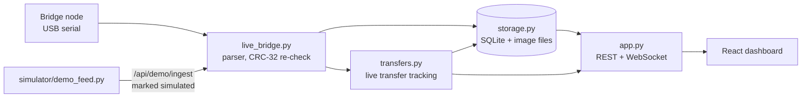

# Backend and dashboard

[Back to the README](../README.md)



## Run it

```bash
pip install -r backend/requirements.txt
cd backend
uvicorn app:app --port 8000
```

The backend looks for a Raspberry Pi serial device. With several Picos plugged in it can pick the
wrong one, so set the bridge's port explicitly:

```powershell
$env:SMARTRELAY_BRIDGE_PORT = "COM5"
```

Nothing else may hold that port, such as a serial monitor. `GET /api/health` shows whether the
bridge is connected.

```bash
cd dashboard
npm install
npm run dev      # development server on http://localhost:5173, forwarding /api and /ws to :8000
npm run build    # production build; the backend then serves it on :8000
```

## What the backend does

- Reads the bridge's `@ALFP` blocks and **recomputes each file's CRC-32**.
- Joins the two transfers of one capture (telemetry and photo) by capture id. A capture whose
  photo has not arrived is shown without an image, which attaches when it arrives. A later
  telemetry record never erases an image.
- Records the bridge's live `@EVT` events in `transfers` and `fragments` tables, and marks a
  silent transfer as timed out.
- Keeps the bridge's ordinary log lines.
- Never classifies anything: sound labels come from the node, and the backend only counts them.

## API

| Endpoint | Returns |
| --- | --- |
| `GET /api/health` | bridge port, connection state and totals |
| `GET /api/nodes` | each node's last activity, from real captures |
| `GET /api/captures`, `GET /api/captures/{id}` | captures |
| `GET /api/transfers`, `/api/transfers/in_flight`, `/api/transfers/{id}` | transfer records |
| `GET /api/species` | count of each sound label |
| `GET /api/log` | bridge log lines |
| `POST /api/demo/ingest` | feeds lines through the same parser, marked as simulated |
| `WS /ws` | a snapshot on connection, then live events |

## Dashboard pages

| Page | Route | Contents |
| --- | --- | --- |
| Overview | `/` | recent captures, activity by hour, mesh log |
| Captures | `/sightings` | all captures; open one for its image, readings, radio and CRC state |
| Species | `/species` | what the nodes heard, grouped by sound group |
| Node | `/node/{id}` | one node's captures and temperature, humidity and light history |
| Review | `/review` | placeholder; the review workflow is not built |

The side panel lists the five nodes and mesh totals, and the page has a light and dark theme.

### Not built yet in this dashboard

These are marked "TBD" on screen:

- the **Arriving now** panel. The backend already receives and serves live transfer progress, but
  this front end does not draw it;
- signal strength and battery per node, and some mesh-health counters;
- capture export and the review workflow.

Node activity is based on received captures: the firmware sends the laptop no per-node heartbeat.

## Demo without hardware

Start the backend with no bridge attached, then:

```bash
python simulator/demo_feed.py --burst 5 --label-images sd_card/samples
python simulator/demo_feed.py --continuous --every 20
python simulator/demo_feed.py --scenario normal        # also: lora, loss, bridge-down
```

`--scenario` plays one live transfer with paced `@EVT` lines. Everything the simulator sends is
stored and shown with a **simulated** badge, and is never mixed with real node data. Its sensor
values and labels are random and are not measurements.
