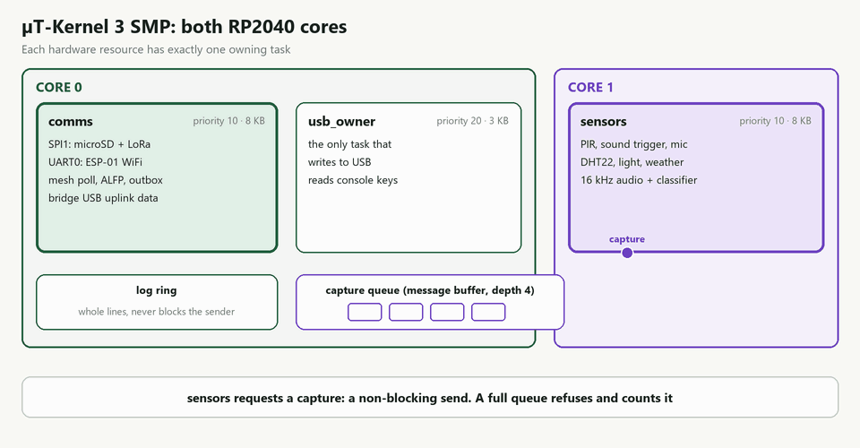

# Dual-core firmware: µT-Kernel 3 SMP (Tribunal 1)

[Back to the README](../README.md)

The requirement was a microkernel that uses **both cores of the RP2040**. The node firmware was
ported from FreeRTOS on one core to **µT-Kernel 3 in SMP mode**: one kernel instance schedules
tasks on core 0 and core 1.



## Which kernel

There is no official µT-Kernel 3 SMP port for the RP2040. The project uses the community port
[TemariVirus/mtk3smp-rp2040](https://github.com/TemariVirus/mtk3smp-rp2040), pinned as a git
submodule at commit `900e863`. It is derived from the official `tron-forum/mtk3_bsp` Pico branch
but is **not** a T-Engine Forum release, and its documented soak testing was short. The risk was
accepted explicitly. Licences are mixed (T-License, Apache-2.0, BSD-3-Clause); see
[provenance](../third_party/MTK3SMP_PROVENANCE.md). Files inside the submodule are never
committed from this repository.

## Tasks and cores

| Task | Core | Priority | Stack | Responsibility |
| --- | --- | --- | --- | --- |
| `comms` | 0 | 10 | 8192 B | both radios, microSD, ALFP receive, timers and pacing, outbox, capture requests, bridge uplink |
| `usb_owner` | 0 | 20 | 3072 B | reads console keys; the only task that writes to USB |
| `sensors` | 1 | 10 | 8192 B | DHT22, light, weather; PIR and sound trigger; audio recording and classification |

A smaller number is a higher priority, and priority only matters between tasks on the same core.
Task stacks come from one 24 KB pool. Press `s` on a node to see the core each task is running on,
its priority and its free stack; the cores are recorded by each task on every loop pass.

Tasks are pinned with `TA_ASSPRC` and `TP_PRC1` (core 0) or `TP_PRC2` (core 1).

## How the tasks talk

| Path | Mechanism | If the receiver is slow |
| --- | --- | --- |
| `sensors` → `comms` capture request | message buffer, depth 4, non-blocking send | refused and counted (`capture q full`) |
| console keys → `comms` / `sensors` | event flags | not applicable |
| any task → USB | log ring of whole lines, drained by `usb_owner` | the sender waits at most 500 ms, then the line is counted as dropped |
| UART0 RX interrupt → `comms` | byte ring under a spinlock | overflow counter and high-water mark |

Lines from the two cores never interleave because each task assembles a whole line before it
enters the ring.

### Rules the port forced

- **No kernel call is safe inside an interrupt** in this port (there are no `i`-prefixed calls).
  An interrupt only touches a ring buffer under `ISpinLock`.
- **Counters shared between cores need a lock.** The Cortex-M0+ has no atomic instructions, so
  `rtos_atomic_add_u32()` and `rtos_atomic_cas_i32()` use a spinlock.
- **Message buffers** cost a 4-byte header per message (`RTOS_MSGQ_BYTES`) and must be created
  with `TA_USERBUF`, or the kernel ignores the buffer it is given.
- **Tick:** 1 ms (the kernel default is 10 ms; the build script changes it). Core 0 is the only
  core that services it. A `delay(n)` waits `n + 1` tick boundaries, so `delay(1)` measures about
  2 ms (console key `k`).

The application never calls the kernel directly. It uses
[`firmware_smp/rtos_port.h`](../firmware_smp/rtos_port.h), implemented for µT-Kernel in
`rtos_port_mtk3.c`.

## The runtime layer the kernel does not provide

The kernel has its own reset handler, clock setup and vector table, so none of the Pico SDK
start-up code runs. `firmware_smp/buildglue/` supplies what the drivers silently depend on:

| Problem | Fix |
| --- | --- |
| The RP2040 timer never counted, so every SDK timeout would spin forever | release DMA, TIMER, PWM and PIO from reset and start the 1 MHz tick |
| The SDK's clock table was empty, so SPI and UART baud calculations would divide by zero | measure each clock with the frequency counter and report it |
| The SDK interrupt code conflicts with the kernel's vector table | a per-interrupt handler table built on `tk_def_int` |
| SD driver mutexes, `sleep_ms`, random numbers | implemented on kernel primitives |
| Heap and `printf` | bounded 24 KB heap with a cross-core lock; reentrant `printf` routed to the log ring |
| About 40% of DHT22 reads failed on two cores | the DHT22 timing code runs from RAM, and core 1 masks interrupts for the roughly 5 ms bit loop |

## Differences from the FreeRTOS build

Both builds share ALFP, both meshes, the sensing code, the SD layout, the console keys and the
uplink format. The **live transfer events** (`@EVT` lines) and the per-second relay summary exist
only in the FreeRTOS build. The dual-core build adds the keys `w`, `k`, `x`, `z` and `B`.

## Building and flashing

Needs Arm GNU Toolchain 14.2 on `PATH`, GNU make, `perl`, Python 3, `PICO_SDK_PATH` (Pico SDK
2.1.1) and `FATFS_PICO_PATH` (both from `tools/fetch_deps.sh`). The kernel has its own Make build,
separate from the CMake build in `firmware/`.

```bash
git submodule update --init third_party/mtk3smp_rp2040
sh firmware_smp/buildglue/check_env.sh                  # report missing tools
firmware_smp/buildglue/build_smp.sh                     # all five nodes -> uf2/
NODE_IDS=2 firmware_smp/buildglue/build_smp.sh          # one node
SMP=0 NODE_IDS=2 firmware_smp/buildglue/build_smp.sh    # single-core fallback
```

- On Windows the submodule must be checked out with **LF** line endings
  (`git -C third_party/mtk3smp_rp2040 config core.autocrlf false`, then check out again),
  otherwise the makefile patch silently does not apply and the link fails.
- Windows may block the kernel's freshly built `elf2uf2.exe`; the script then uses
  `elf2uf2.py`.
- The build patches files in the submodule's working tree. Restore it with
  `git -C third_party/mtk3smp_rp2040 checkout -- . && git -C third_party/mtk3smp_rp2040 clean -fdx`.
- `smoke/` holds a small kernel-only test application (`build_smoke.sh`).

To flash, hold BOOTSEL and drag `uf2/csc09_smp_node_N.uf2` onto the drive, or press `B` on a node
already running the dual-core build. `flash_node.py` and `serial_tstamp.py` automate flashing and
console capture.

## Evidence from the boards

Measured on 19 November 2026 with node 1 (bridge) and node 2 on the dual-core build. Full report:
[verify/RESULTS.md](verify/RESULTS.md).

| Check | Result |
| --- | --- |
| Core assignment | `comms: core 0`, `usb_owner: core 0`, `sensors: core 1` in both boot logs |
| Message queue self-test at boot | passed on both queues |
| 60-minute soak | 107 of 107 files received and streamed to the laptop, 0 CRC failures on replay |
| Longest bridge communications loop | 242 ms maximum |
| DHT22 | 1730 and 1617 good reads, 0 failures |
| Audio samples lost across 54 captures | 0 |
| Minimum free stack | `comms` 5040 of 8192 B, `usb_owner` 2192 of 3072 B, `sensors` 7392 of 8192 B |

Shorter side-by-side runs against the FreeRTOS firmware on the bridge are in
[evidence/smp/](evidence/smp/), with the queue-full (T6) and console-stall (T8) tests.

These measurements were taken before the later live-transfer changes and the coding-standard
rewrite.

### Five boards, 25 November 2026

All five nodes on this build: boot logs showed `comms` and `usb_owner` on core 0 and `sensors` on
core 1 on every node, and the message-queue self-test passed. 256 file transfers completed with none
lost, through two-hop WiFi relaying, 30% injected loss, the bridge unplugged and the relay removed
(LoRa fallback). Report and logs:
[testing/results/2026-11-25-five-nodes/](testing/results/2026-11-25-five-nodes/REPORT.md).

## Not verified

A run with the ESP-01 physically removed has not been done (removing the WiFi relay was). The
single-core fallback (`SMP=0`) has been built but not run on hardware. The five-board run used images
from before the coding-standard restyle; see [CODING_STANDARD.md](CODING_STANDARD.md#verification)
for how the restyled code was checked.
