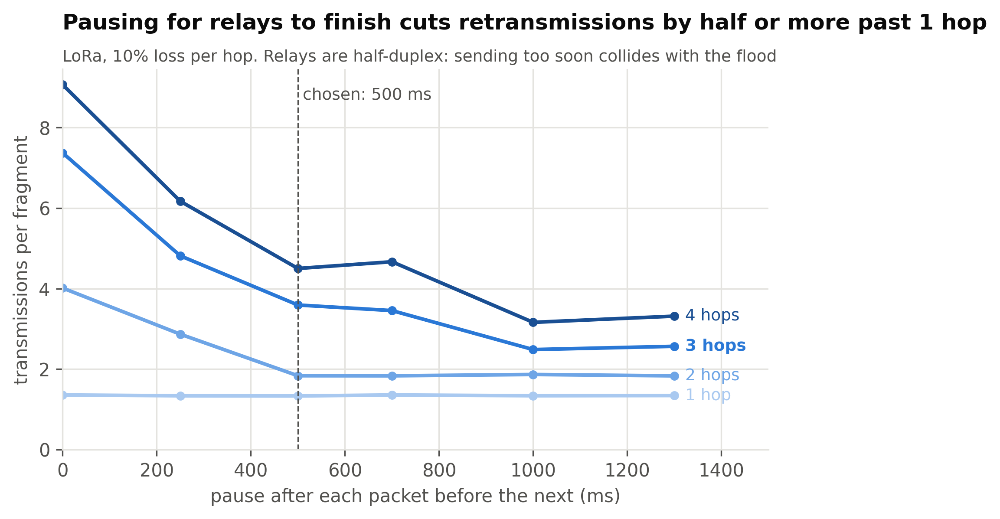
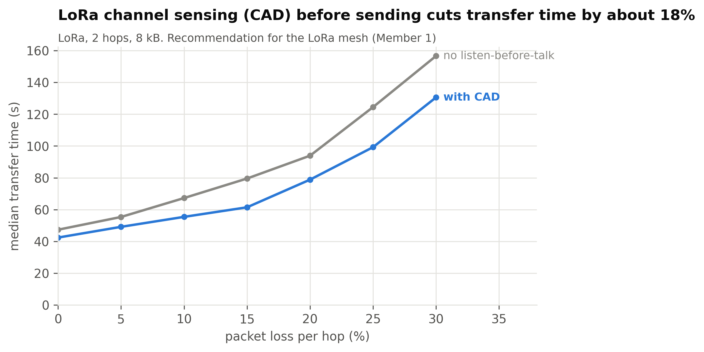

# Protocols

[Back to the README](../README.md)

From the radio up: the two meshes, the serial link to the WiFi module, ALFP, the capture record,
and the bridge's USB output.

```text
 capture record (capture_meta.h)       travels inside the ALFP manifest
 ALFP (alfp/)                          fragments, CRCs, retransmission
 mesh_radio_t (mesh/mesh_radio.h)      send / recv / poll
 LoRa mesh        | WiFi mesh          flooding, duplicates, hop limit
 LR1121 on SPI1   | serial frames over UART0 -> ESP-01S -> ESP-NOW
```

## 1. The shared radio interface

Both meshes export one `mesh_radio_t`: a name and function pointers for `send`, `recv`, `poll`,
`max_payload`, `last_heard`, `tx_busy`, `get_stats` and `set_drop_rate`. The contract:

- delivery is byte-exact and best effort: no mesh acknowledgements, retries or ordering;
- corrupt packets are dropped, never delivered;
- `send` and `recv` return within a few milliseconds; transmission happens in `poll`;
- radio problems are counted in statistics and are never fatal.

Every mesh packet starts with a 5-byte header:

| Bytes | Field |
| --- | --- |
| 1 | `src`: node that created the packet |
| 1 | `dst`: node 1 to 5, or `0xFF` for everyone |
| 2 | `pkt_id`: used with `src` to spot duplicates |
| 1 | `hops`: relays still allowed |

## 2. Flooding

On receiving a packet a node:

1. drops it if the radio's CRC failed or the header is malformed;
2. drops it if `(src, pkt_id)` was seen in the last 30 s (this includes its own echoes);
3. delivers it if `dst` is this node or broadcast;
4. if it was not only for this node and `hops` is above 0, waits a short random time and
   rebroadcasts it with `hops - 1`.

The random wait keeps two relays from transmitting at the same instant.

| Constant | WiFi | LoRa |
| --- | --- | --- |
| Hop limit | 4 | 4 |
| Relay delay | 5 to 30 ms | 10 to 100 ms |
| Duplicate cache | 1024 entries, 30 s | 128 entries, 30 s |
| Send / relay / receive queues | 8 / 8 / 8 | 8 / 8 / 8 |
| Heartbeat from the bridge | 3 s | 3 s |

A node may start a transfer on a radio only if it has heard the bridge on that radio within 10 s.

## 3. LoRa

| Setting | Value |
| --- | --- |
| Radio | Waveshare Core1121-HF (Semtech LR1121) |
| Frequency | 924.2 MHz (AS923) |
| Modulation | SF7, 125 kHz bandwidth, coding rate 4/5 |
| Preamble / sync word | 8 symbols / `0x12` (private network) |
| Transmit power | 14 dBm |
| Maximum packet | 255 B, giving 250 B after the mesh header |

LoRa is half duplex: a node cannot hear while it transmits. A relay needs time to forward one
fragment before the sender sends the next, which is why ALFP waits 500 ms between LoRa packets.



Listen-before-talk (channel activity detection) was tested in the simulator only; it made
transfers 18% faster there and is a recommendation, not part of the firmware.



## 4. WiFi

Each node has an ESP-01S in the Maker board's socket, called a **WST** (WiFi serial transceiver),
running ESP-NOW bridge firmware. That module firmware is not part of this repository. The Pico
talks to it over UART0 (GP16 transmit, GP17 receive, 115200 baud) with CRC-framed messages:

| Direction | Message | Frame (all start with `0xAA`) |
| --- | --- | --- |
| Pico → WST | SEND | `AA 01 len packet crc` |
| Pico → WST | WHOAMI | `AA 05 crc` |
| WST → Pico | RECV | `AA 02 len mac[6] packet crc` |
| WST → Pico | TXDONE | `AA 03 status crc` (0 = sent) |
| WST → Pico | HELLO | `AA 04 mac[6] crc` |

The CRC is CRC-8, polynomial `0x07`, initial value 0, over everything after `0xAA`. Only one
radio transmission is in flight at a time. An interrupt stores received bytes in a 2048-byte ring.
An ESP-NOW packet is at most 250 B, leaving **245 B** of mesh payload.

The mesh identifies the sending module by its MAC address
([`wifi_mesh_config.h`](../third_party/wifi_mesh/wifi_mesh_config.h)). That is what makes the
**topology filter** possible, and why each board needs its matching WST.

## 5. ALFP

Design reasoning and measurements are in [ALFP.md](ALFP.md). All fields are little-endian, every
packet ends with CRC-16/CCITT-FALSE over the preceding bytes, and `b0` holds the version (high
4 bits, currently 1) and the type (low 4 bits).

| Type | Layout | Size in bytes |
| --- | --- | --- |
| 1 MANIFEST | b0, sid2, size4, count2, fsize2, crc32 4, radio1, metalen1, meta, crc2 | 19 + meta |
| 2 DATA | b0, sid2, seq2, count2, payload, crc2 | payload + 9 |
| 3 POLL | b0, sid2, round1, crc2 | 6 |
| 4 NACK | b0, sid2, flags1, round1, fmt1, body, crc2 | 8 or more |
| 5 ACK | b0, sid2, status1, crc2 | 6 |

NACK formats: `ALL`, `LIST` (count, then sequence numbers), `BITMAP` (base, bit count, bits) and
`NONE`. ACK status: `OK`, `CRC_FAIL`, `BUSY`, `STORAGE`, `TOO_BIG`.

| Timing profile | LoRa | WiFi |
| --- | --- | --- |
| Gap between packets | 500 ms | 10 ms |
| Poll timeout | 1500 ms | 200 ms |
| Unanswered polls before giving up | 30 | 40 |
| Maximum rounds | 40 | 40 |
| Bridge expires an idle session after | 60 s | 15 s |
| Fragment payload (largest file) | 241 B (123,392 B) | 236 B (120,832 B) |

When four or fewer fragments are missing, each is sent twice.

## 6. Capture record

Sensor readings and the sound result travel with each file in a 31-byte little-endian record
([`common/capture_meta.h`](../common/capture_meta.h)). A reading that failed is sent as a
"missing" value, never as an invented number.

| Offset | Field | Offset | Field |
| --- | --- | --- | --- |
| 0 | version (2) | 18 | weather confidence |
| 1 | node id | 19 | trigger trust |
| 2 | capture id (4 B) | 20 | sound class |
| 6 | uptime ms (4 B) | 21 | sound confidence |
| 10 | trigger flags (PIR, sound) | 22 | sound RMS (2 B) |
| 11 | temperature × 10 (2 B) | 24 | zero crossings per second (2 B) |
| 13 | humidity × 10 (2 B) | 26 | sample image index |
| 15 | light (2 B) | 27 | `queued_ms`: trigger to send start (4 B) |
| 17 | weather label | 31 | optional file name |

Version 1 records are the first 27 bytes; both versions are accepted. Neither classifier tree
produces a weather confidence or trigger trust, so those two stay "unknown".

A capture is sent as two transfers sharing one capture id: the **telemetry** record alone (tagged
`TELEMETRY`) and the **photo**. The backend joins them, so telemetry can arrive first.

## 7. Bridge to laptop (USB serial)

The output is plain text, so it can share the port with ordinary log lines.

**Finished file:**

```text
@ALFP FILE v1 src=3 sid=00042 size=8000 crc=1a2b3c4d radio=lora frags=34 first=... done=... nacks=1 dups=2 meta=0203...
@D <base64, 64 characters per line>
@ALFP END crc=1a2b3c4d
```

The header is one line. The laptop recomputes the CRC-32 before accepting the file. The bridge
sends a few lines per loop pass so that the radios are still polled during an upload.

**Live transfer events** (FreeRTOS bridge only), one line each:

| Event | Meaning | Main fields |
| --- | --- | --- |
| `@EVT RXS` | a session started | source, session, radio |
| `@EVT RXM` | manifest received | fragment count and size, file size, CRC, metadata |
| `@EVT RXF` | a fragment arrived | sequence, round, hops, relay node, duplicate flag |
| `@EVT NACK` | the bridge asked for resends | round, number missing |
| `@EVT RXOK` | verified on the bridge | |
| `@EVT RXFAIL` | failed or refused | reason; `crc` is not final, the file is requested again |

Every event also carries the source node, the session id and the bridge time in milliseconds. On
LoRa the relay is reported as unknown, because the LoRa header does not carry the previous hop.
The backend stores only what the bridge reported; anything not reported stays empty.
