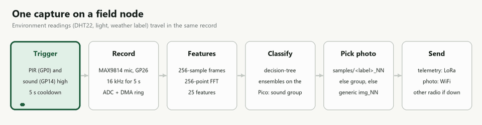
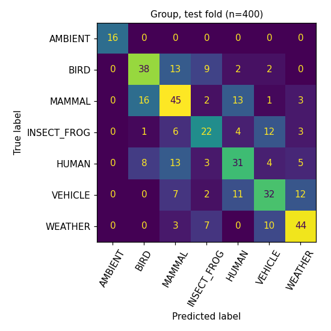

# Sensors and on-node classification

[Back to the README](../README.md)

## Parts and pins

| Part | Pin | Interface |
| --- | --- | --- |
| PIR motion sensor | GP0 | digital input, pull-down |
| Sound trigger module | GP14 | digital input, pull-down |
| MAX9814 microphone | GP26 / ADC0 | analog, ADC + DMA |
| DHT22 | GP4 | one-wire, timed in software |
| Light module (SN-LIGHT-MOD) | GP27 / ADC1 | analog, 12-bit |
| Maker button 1 | GP20 | "capture now" |

The sound trigger and the microphone are separate parts: the module only says "loud or not", and
the microphone records what is classified. Full wiring, including the radios and SD card, is in
[BRINGUP.md](BRINGUP.md).

Code: the original sensor drivers are in `third_party/sensors/`; `firmware/sensing/` connects them
to the capture pipeline.

## Trigger

A capture starts when the PIR **and** the sound trigger are high in the same poll, followed by a
5 s cooldown. The `c` key and the GP20 button start one by hand.

## Environment readings

- The DHT22 is read about every 2 s (the driver refuses reads closer than 2000 ms). A reading
  older than 10 s is reported as **missing**, as are out-of-range values.
- Its bit timing must not be interrupted. The FreeRTOS build raises the sensor task's priority for
  those few milliseconds; the dual-core build masks interrupts on core 1 and runs the timing code
  from RAM.
- A small decision tree ([`weather_tree.h`](../third_party/sensors/weather_tree.h)) turns
  temperature, humidity and light into `Cloudy`, `Hot_Dry` or `Humid_Rainy`.

## Audio capture

The original design recorded into one buffer: 5 s × 16 kHz × 2 B = 160 kB, about 60% of the
RP2040's RAM, which does not fit beside two radio stacks and the SD driver. Instead the ADC runs
at 16 kHz on its own clock and DMA writes into a **16 kB ring** (about 512 ms), which the sensor
task consumes while recording continues. Lost samples are counted and printed (`lost=0`). The raw
audio is never stored or transmitted.

## Features

The MAX9814 has automatic gain control, so absolute loudness says little about the source. The
features describe the **shape** of the spectrum instead:

1. cut the samples into 256-sample frames (16 ms);
2. remove each frame's mean, apply a Hann window, and scale up quiet frames before the integer FFT;
3. run a 256-point fixed-point (Q15) FFT: the RP2040 has no floating-point unit;
4. sum the power into 8 bands from 62 Hz to 8 kHz, as ratios of the frame's total;
5. keep running statistics only, never the frames.

The result is **25 features**: mean and spread of each of the 8 bands, spectral centroid,
zero-crossing rate, loudness spread and range, the share of active frames, spectral flux, and
overall level. The same C file runs on the laptop, so training sees exactly the numbers the node
computes (`ml/check_parity.py` compares the two).

## Classifier

Two stages of small decision-tree ensembles, trained with scikit-learn and exported as constant
tables in `firmware/sensing/sound_model.h` (about 12.6 kB of flash):

- **Stage 1** chooses a group: `AMBIENT`, `BIRD`, `MAMMAL`, `INSECT_FROG`, `HUMAN`, `VEHICLE` or
  `WEATHER`.
- **Stage 2** proposes an animal inside the three animal groups. Its answer is kept only above a
  confidence threshold.

The training clips come from **ESC-50**, played through a speaker and re-recorded by the node's
own microphone: 510 takes, split by ESC-50 fold (folds 1 to 3 train, 4 validation, 5 test), with
all takes of one clip kept in the same split.

## What the classifier can and cannot do

Test-fold results from the [model card](sound/model_card.md), computed with the same quantised
model the node runs:

| Metric | Result |
| --- | ---: |
| Group accuracy (7 groups) | 49.0% |
| Group macro-F1 | 0.499 |
| Animal against not-animal accuracy | 81.4% |
| Same question, earlier energy and zero-crossing thresholds | 47.1% |

**It does not name species or animals.** With only 12 training takes per animal, stage 2 was not
reliable enough, so the exported threshold (`SOUND_STAGE2_MIN_CONF = 101`) can never be reached.
The node reports the group only. The dashboard page called "Species" is a tally of these labels,
and the simulator may send animal labels that this model would not produce.

Other limits: ESC-50 is not Singapore wildlife; clips played through a speaker in a room are not
field conditions; and the figures above come from a small test set.

## Choosing the photo

There is no camera. `sound_image_pick.c` looks on the card for `samples/<label>_NN.jpg`, then the
group's images, then generic `img_NN.jpg`, taking turns within a set. If nothing matches, it takes
any group's image, and the telemetry is sent in every case. Image sources and licences:
[IMAGE_CREDITS.md](sound/IMAGE_CREDITS.md).

## Retraining

The pipeline (record, extract, train, export) is described in [ml/README.md](../ml/README.md).
Building with `-DSOUND_LEGACY_MODE=ON` restores the earlier threshold method for comparison.
