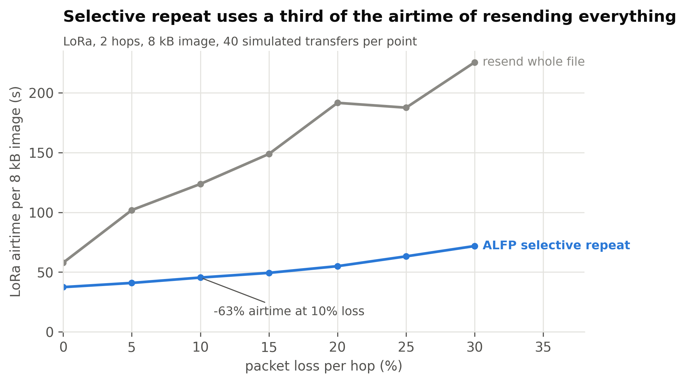
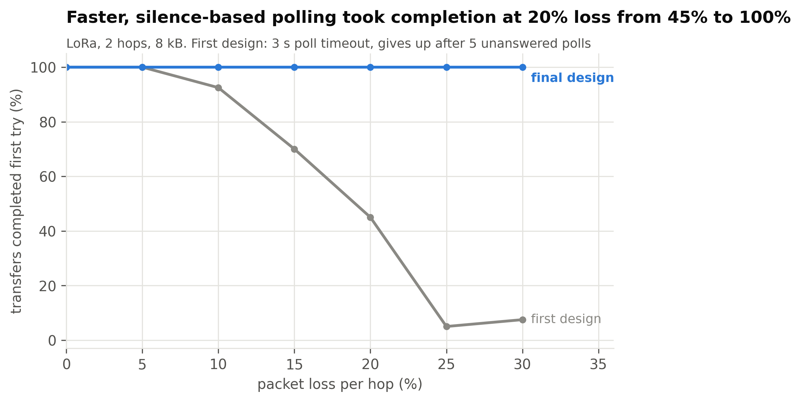
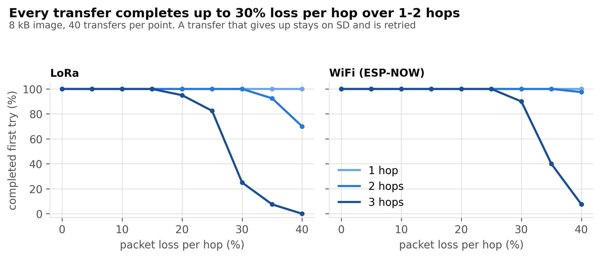

# Testing and evidence

[Back to the README](../README.md)

## One command

```bash
tools/run_all_tests.sh
```

It runs the style check, host tests, mesh integration, backend tests and ML tests, and prints a
summary. A stage whose tools are missing is reported as **SKIPPED**, never as passed. The host
code needs a POSIX system (Linux, macOS, or WSL on Windows).

With CMake, the full host suite, including AddressSanitizer and UndefinedBehaviorSanitizer:

```bash
cmake -S host -B build && cmake --build build -j && ctest --test-dir build --output-on-failure
python -m pytest backend/tests ml/tests
```

## What is covered

| Area | Tests |
| --- | --- |
| Packet formats and CRCs | `test_units.c`: encode and decode, corrupted bits, capture record versions 1 and 2 |
| Transfers | `test_transfer.c`: loss, corruption, resume, radio choice at every size boundary, no radio change mid-transfer, bridge reboot |
| Filtering | `test_filtering.c`: duplicates, packets for other nodes, 30% loss, heartbeat |
| USB uplink | `test_uplink.c` and `tools/test_bridge_receiver.py` |
| Sensing | `test_audio.c` (streaming features against the original microphone code), sound features, model against the Python twin, image choice, sound label tables, capture ids |
| Real mesh code | `host/integration/`: the real `lora_mesh.c` and `wifi_mesh.c` in separate processes over a fake radio, with 20% loss; WiFi runs E → C → A through the topology filter |
| Backend | `backend/tests/`: sound labels, joining telemetry with images, transfer events, verification tool |
| ML tools | `ml/tests/` |

`tools/demo_multihop.py` shows the multi-hop path and relay counters on a laptop.

## Results on the final code (28 November 2026)

| Check | Result |
| --- | --- |
| `tools/check_style.sh` | passed: layout, source rules, warnings-as-errors compile |
| Host build and test steps, with sanitizers, gcc 15 on WSL | all passed. CMake was not installed, so a script mirrored `host/CMakeLists.txt` |
| `tools/run_all_tests.sh` on WSL | style, host tests and integration passed; backend and ML skipped there (no pytest in WSL) |
| `backend/tests` and `ml/tests` on Windows | 38 passed |
| Dashboard `npm run build` | passed |
| FreeRTOS firmware, all images | built |
| Dual-core firmware, nodes 1 to 5 | built |
| Optional builds | legacy sound mode and no-radio built; single-core kernel (`SMP=0`) built |
| Kernel smoke application | linked; Windows blocked the kernel's UF2 helper afterwards |
| `tools/demo_multihop.py` | passed: E → C → A, byte-for-byte identical |

No hardware test has been run on these final images. How the restyled code was checked against
the code before it: [CODING_STANDARD.md](CODING_STANDARD.md#verification).

## Hardware results (19 November 2026)

Node 1 and node 2 on the dual-core build. Details and raw logs:
[verify/RESULTS.md](verify/RESULTS.md).

| Measure | Before fixes | After |
| --- | --- | --- |
| Longest bridge loop over 60 minutes | about 4000 ms | 242 ms |
| WiFi image transfer, 9 to 10 KB, mean | 9.3 s | 2.4 s |
| LoRa telemetry, 27 B, mean | 7.3 s | 1.0 s |
| 60-minute soak | | 107 of 107 files delivered, 0 CRC failures on replay |

The cause of the slowdown was found by timing every SD call: one very large folder made each
file operation scan hundreds of entries, and the bridge uploaded files from inside the receive
callback. Also tested: queued captures surviving a node reset, and the backend end to end.

## Simulator experiments

Timing values in the protocol were chosen with `host/experiments/` over the mesh simulator. These
are simulation results, not field measurements. Raw data is in `results/`; charts are made by
`tools/make_figures.py`.

| Selective repeat | Design iterations |
| --- | --- |
|  |  |



## Hardware results (25 November 2026)

All five boards on the dual-core build (commit `463f028`, before the coding-standard restyle). Full
report and 53 raw logs: [testing/results/2026-11-25-five-nodes/](testing/results/2026-11-25-five-nodes/REPORT.md).
Procedure: [testing/HARDWARE_TEST.md](testing/HARDWARE_TEST.md).

| Measure | Result |
| --- | --- |
| File transfers completed | 256 across four field nodes; none lost (the 3 that gave up were retried and delivered) |
| Telemetry over LoRa, direct | 104 transfers, median 0.9 s |
| Photo over WiFi, 1 hop / 2 hops | median 2.6 s (83 transfers) / 3.3 s (32 transfers) |
| Photo over LoRa when the WiFi relay was removed | 43.5 s median, all delivered |
| Multi-hop | node 4 relayed 140 → 574 packets for node 5, which has no direct WiFi link to node 1 |
| 30% packet loss | every file `done`; 10–31 fragments resent per image |
| Bridge unplugged | 20, 20 and 14 files queued on nodes 3, 4 and 5; all delivered once it returned |
| Hardware faults found | node 2's LoRa module (receives nothing) and node 5's microphone (flat signal) |

Every requirement with its test and evidence: [testing/TRACEABILITY.md](testing/TRACEABILITY.md).

## Known gaps

- **Five boards on the final images:** the five-node run used images built before the restyle and
  the live-transfer feature; the restyle was checked at machine-code level instead
  ([CODING_STANDARD.md](CODING_STANDARD.md#verification)).
- **Live transfer events on hardware:** the acceptance checklist for this feature has not been
  filled in. It was tested with the simulator and backend tests only.
- **Hop-limit drops** are untested: the simulator cannot build a chain long enough.
- **WiFi failing during a transfer** was shown on hardware by removing the relay (25 Nov, Step 6B):
  the transfer gave up and was delivered over LoRa. Removing the ESP-01 itself was not tried.
- **ESP-01 physically removed** on the dual-core build: not run.
- **Size ladder:** only the 1024 B and 65,536 B payloads were run through the real mesh code.

## Hardware acceptance checklist for live transfers

Flash all five nodes with the FreeRTOS images, keep the topology filter on, run the backend on the
bridge laptop, then press `c` on node 5.

| # | Step | Expected |
| --- | --- | --- |
| 1 | `s` on node 1 before and after | longest communications loop not noticeably higher |
| 2 | `c` on node 5 | `/api/transfers/in_flight` shows node 5 within about 1 s |
| 3 | same transfer | relay is node 3 or 4, hops = 2 |
| 4 | after verification | the record has radio time, queued time, upload time and CRC results |
| 5 | `d` on node 1, then `c` on node 5 | NACKs and resends; the file still verifies |
| 6 | small file over LoRa | hops reported, relay unknown |
| 7 | unplug node 1's USB during a transfer | the transfer completes or is marked timed out |
| 8 | watch nodes 3 and 4 | relay summary lines show packets from node 5 |
