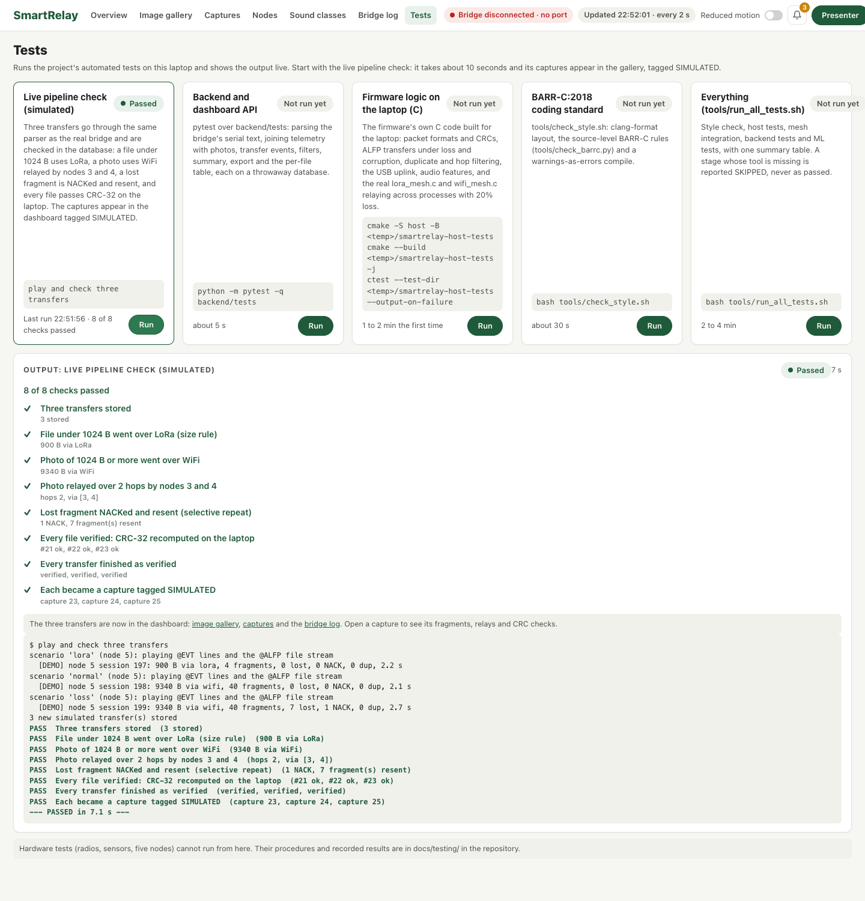

# Testing

[Back to the README](../../README.md)

How SmartRelay was tested, how to run the tests yourself, and where every result is.

| File | Contents |
| --- | --- |
| [TRACEABILITY.md](TRACEABILITY.md) | every requirement (FR1–FR12, NFR1–NFR11, the µT-Kernel 3 SMP change, tribunal tests T1–T8, BARR-C) with its automated test, hardware evidence and status |
| [HARDWARE_TEST.md](HARDWARE_TEST.md) | step-by-step procedure for the five boards: boot, sensors, radios, capture, multi-hop, packet loss, bridge offline, overload |
| [results/2026-11-25-five-nodes/](results/2026-11-25-five-nodes/REPORT.md) | the five-board run: report, 53 timestamped serial logs and the console script used |
| [SmartRelay_Test_Report.docx](SmartRelay_Test_Report.docx) | the same material as one document for submission |
| [../FAULTS.md](../FAULTS.md) | how each fault is detected, handled and recovered, and the size of every queue and buffer |
| [../TESTING.md](../TESTING.md) | what each test suite covers, earlier hardware results and known gaps |

## Automated tests

### From the dashboard

1. Start the backend and dashboard (Python 3.10+ and Node 20+):

   ```bash
   pip install -r backend/requirements.txt pytest
   cd dashboard && npm install && npm run build && cd ..
   cd backend && uvicorn app:app --port 8000
   ```

2. Open http://127.0.0.1:8000/tests on the same laptop.
3. Press **Run** on a suite. Its output streams into the page and the card keeps the result.

Start with **Live pipeline check** (about 10 s): it plays three simulated transfers through the same
parser the real bridge uses and checks eight things in the database, then the three captures appear in
the gallery tagged SIMULATED. **Everything** runs the whole set below.



### From a terminal

```bash
tools/run_all_tests.sh
```

Runs the five stages below and prints one summary table. A stage whose tool is missing is reported
SKIPPED, never as passed. Needs a C compiler, CMake (optional), clang-format, Python 3 with `pytest`,
`backend/requirements.txt` and, for the ML stage, `numpy`.

| Stage | Command on its own | What it covers |
| --- | --- | --- |
| Coding standard | `tools/check_style.sh` | BARR-C:2018 layout (clang-format), source rules (`tools/check_barrc.py`), warnings-as-errors compile |
| Host tests | `cmake -S host -B build && cmake --build build && ctest --test-dir build` | packet formats and CRCs, ALFP under loss and corruption, radio choice, store-and-forward, two senders at once, uplink, audio features, classifier |
| Mesh integration | `host/integration/run_integration.sh`, `run_wifi_integration.sh` | the real `lora_mesh.c` and `wifi_mesh.c` in separate processes over a fake radio with 20% loss, WiFi relayed E → C → A |
| Backend | `python -m pytest backend/tests` | parsing the bridge's serial text, joining telemetry with photos, transfer events, dashboard API, the pipeline check and the Tests page |
| ML | `python -m pytest ml/tests` | the sound feature pipeline and demo playlist |

### Results on the final code (28 November 2026, macOS)

| Stage | Result |
| --- | --- |
| Coding standard | passed: clang-format, `check_barrc.py` and the warnings-as-errors compile |
| Host tests and mesh integration | 14 of 14 `ctest` tests passed |
| Backend | 46 passed |
| ML | 10 passed |
| Dashboard build (`npm run build`, includes the TypeScript check) | passed |
| Tests page, each suite run from the browser | pipeline 8/8 checks, style passed, host 14/14 |

## Hardware tests

The hardware cannot be driven from a laptop alone, so these were run by hand on the boards and logged.

| Date | Boards | What | Result |
| --- | --- | --- | --- |
| 11 Nov | nodes 1, 2 | the same captures on FreeRTOS and on the dual-core build | identical transfer times; [evidence/smp/](../evidence/smp/) |
| 19 Nov | nodes 1, 2 | 60-minute soak on the dual-core build, plus T2, T6, T8 | 107 of 107 files, 0 audio samples lost, 0 DHT22 failures; [verify/RESULTS.md](../verify/RESULTS.md) |
| 25 Nov | all five | [HARDWARE_TEST.md](HARDWARE_TEST.md) Steps 1–9 on the dual-core build | 256 transfers, none lost; two hardware faults found; [report](results/2026-11-25-five-nodes/REPORT.md) |

The final firmware images were rebuilt after the coding-standard restyle and have not been run on all
five boards. The restyle was checked at machine-code level: every function is identical except three
deliberate defect fixes ([CODING_STANDARD.md](../CODING_STANDARD.md#verification)).
