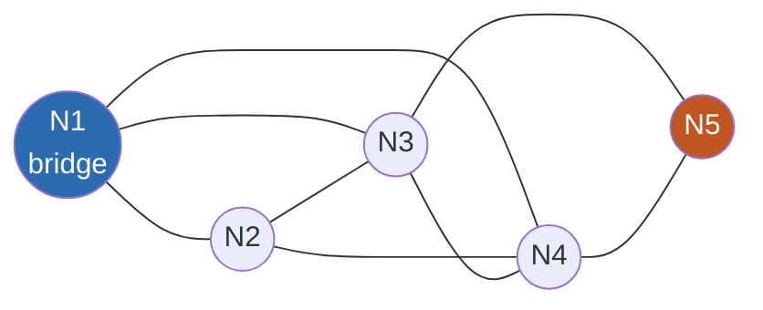
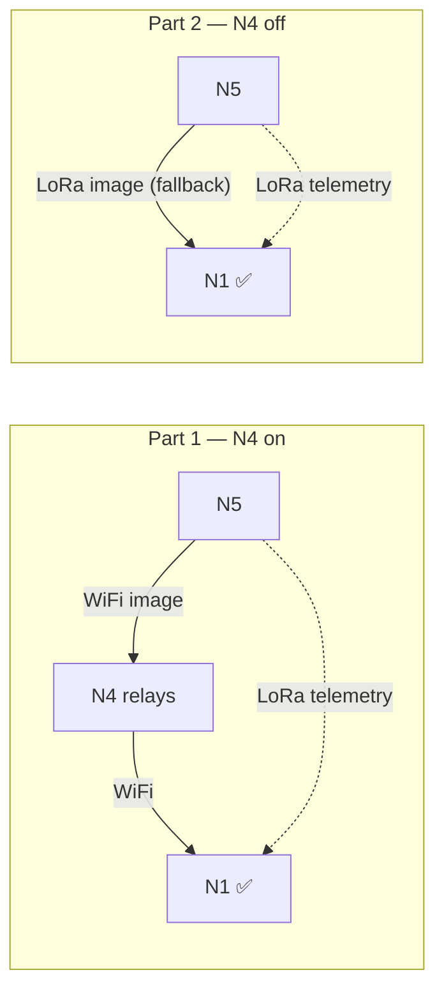

# SmartRelay — Five-Node Hardware Test Report

| | |
|---|---|
| **Test plan** | [Hardware test procedure](../../HARDWARE_TEST.md) (Steps 1–9) |
| **Date** | 2026-11-25 |
| **Firmware** | `csc09_smp_node_{1..5}.uf2` — dual-core µT-Kernel 3 SMP build, commit `463f028` (before the BARR-C restyle; see [the note below](#firmware-version)) |
| **Nodes** | N1 bridge + field nodes N2, N3, N4, N5 (Raspberry Pi Pico W on Maker Pi Pico, Core1121/LR1121 LoRa, ESP-01 WiFi) |
| **Sessions** | Session 1: N1 bring-up + N2 full run<br>Session 2: N1 reflash, N3, N4, N5, Step 6A + 6B, N2 re-check |
| **Raw evidence** | 53 timestamped serial logs in [`logs/`](logs/) |

---

## Summary

> **Overall: PASS at system level, with 2 open hardware faults.**
> Every feature in the test plan was demonstrated on real hardware: size-based radio selection, ALFP
> fragment repair under 30 % loss, store-and-forward while the bridge is offline, multi-hop WiFi
> relaying, and automatic LoRa fallback when the relay disappears. **256 file transfers completed
> across the four field nodes and no file was lost** — the 3 transfers that gave up (bridge or relay
> unplugged mid-transfer) were automatically retried and delivered.

| | N1 bridge | N2 | N3 | N4 | N5 |
|---|:-:|:-:|:-:|:-:|:-:|
| Boot / ESP-01 match / SD | ✅ | ✅ | ✅ | ✅ | ✅ |
| LoRa radio | ✅ | ❌ module fault | ✅ | ✅ | ✅ |
| WiFi radio | ✅ | ✅ | ✅ | ✅ | ✅ (via relay) |
| Sensors | n/a (no DHT22) | ✅ | ✅ | ✅ | ⚠️ mic flat |
| Capture → delivery (Step 5) | sink | ⚠️ tel via fallback | ✅ 5/5 | ✅ 5/5 | ✅ 5/5 |
| Packet loss recovery (Step 7) | — | ✅ | ✅ | ✅ | ✅ |
| Store-and-forward (Step 8) | — | ✅ | ✅ | ✅ | ✅ |
| Stress (Step 9) | — | ✅ | ✅ | ✅ | ✅ |
| Multi-hop (Step 6) | — | ✅ 6A | ✅ 6A | ✅ 6B relay | ✅ 6B relay + fallback |

**Open items:** replace / re-test N2's Core1121 module · fix N5's analog mic wiring (GP26).

---

## 1. System under test

Field nodes capture an event (PIR + sound trigger or manual `c`), record 5 s of audio, classify it,
and produce two files: a small **telemetry** record and a **JPEG**. Files go only to the **bridge (N1)**
using **ALFP**, our fragment/ACK/selective-repeat transfer protocol. The radio is chosen by size:

| File | Size | Preferred radio | If preferred radio can't reach the bridge |
|---|---|---|---|
| Telemetry `tel/…` | 27 B | **LoRa** (`reason=size`) | WiFi (`reason=fallback`) |
| Image `samples/….jpg` | 8.4–10.1 kB | **WiFi** (`reason=size`) | LoRa (`reason=fallback`) |

On a bench every radio hears every other, so the WiFi mesh applies a **topology filter**
([`wifi_mesh_config.h`](../../../../third_party/wifi_mesh/wifi_mesh_config.h)) to recreate the trail layout from
the proposal. Each node drops WiFi frames from ESP-01s that are not its neighbour. LoRa is unfiltered
(it would reach the bridge on a real trail).



*WiFi neighbours with the filter ON. **N5 has no direct WiFi link to N1** — its images must be relayed
by N3 or N4, which is what Step 6B proves.*

---

## 2. Test setup

- One Mac, up to three boards on USB at once; each console logged with host timestamps.
- Boards were identified by their ESP-01 (`w` → `WST-N | firmware node N | MATCH`), not by USB port
  name, because port names depend on the host.
- Every field node was freshly flashed with today's UF2 via BOOTSEL; N1 was reflashed at the start.
- SD cards on all field nodes held the 35-image / 19-class `samples/` set.
- Bench conditions: all boards within ~1 m, PIR sensors facing people, so nodes also self-triggered
  captures every 10–15 s throughout (every one of those was delivered too).

---

## 3. Per-node bring-up (Steps 1–4)

| Node | Boot | SD images | LoRa (LR1121) | WiFi | ESP-01 (`w`) | DHT22 | Bridge heard lora / wifi |
|---|---|---|---|---|---|---|---|
| N1 | ✅ `node 1 ready (bridge)` | 0 (bridge needs none) | fw 0x0101, 924.2 MHz SF7 BW125 14 dBm | up | WST-1 MATCH | not fitted | — |
| N2 | ✅ | 35 / 19 groups | chip OK, **receives nothing** | up | WST-2 MATCH | 23.3 °C / 62 % | **never** / 0.5 s |
| N3 | ✅ | 35 / 19 groups | fw 0x0101 | up | WST-3 MATCH | 23.3 °C / 61 % | 2.0 s / 2.0 s |
| N4 | ✅ | 35 / 19 groups | fw 0x0101 | up | WST-4 MATCH | 23.9 °C / 62 % | 0.4 s / 0.4 s |
| N5 | ✅ | 35 / 19 groups | fw 0x0101 | up (relayed) | WST-5 MATCH | 23.3 °C / 59 % | 1.1 s / 1.1 s |

All nodes: dual core confirmed (`comms` + `usb_owner` on core 0, `sensors` on core 1), message-queue
self-test `ok`, `no SD errors`. PIR and sound triggers fired on every node.

---

## 4. Capture and delivery (Step 5)

Five manual captures per node, bridge console confirming each file
(`rx from node N: …, via lora|wifi, 0 dup`).

| Node | Delivered | Telemetry → LoRa | Image → WiFi | Avg LoRa | Avg WiFi | Fallbacks | Failures |
|---|---|---|---|---|---|---|---|
| N2 | 5/5 (session 1) + 10 more in session 2 | ❌ went WiFi (`fallback`) | all | — | 2.6 s | telemetry, every time | 0 |
| N3 | 5/5 | 5/5 | 5/5 | **0.88 s** | **2.36 s** | 0 | 0 |
| N4 | 5/5 | 5/5 | 5/5 | **0.86 s** | **2.52 s** | 0 | 0 |
| N5 | 5/5 | 5/5 | 5/5 (2 hops) | **0.86 s** | **3.16 s** | 0 | 0 |

**Whole-session timing** (all `done` transfers outside the loss test):

| Path | Transfers | Min | Median | Max |
|---|---|---|---|---|
| Telemetry over LoRa, direct | 104 | 0.8 s | 0.9 s | 11.3 s* |
| Image over WiFi, 1 hop (N2/N3/N4) | 83 | 2.1 s | 2.6 s | 4.6 s |
| Image over WiFi, 2 hops (N5 → N4 → N1) | 32 | 2.7 s | **3.3 s** | 6.1 s |
| Image over LoRa, fallback (N5, relay off) | 3 | 43.4 s | **43.5 s** | 44.3 s |

<sub>* Outliers are channel contention while three nodes and their PIR triggers were all active.</sub>

The reference figures in the test plan (LoRa ≈ 1.0 s, WiFi ≈ 2.4 s) were met. The extra relay hop
costs ≈ 0.7 s per image; losing WiFi entirely costs ≈ 16× on images but **still delivers**.

---

## 5. Multi-hop relaying (Step 6)

### 6B — Group B: N5 → N4 → N1 (required) ✅

| Part | Setup | Evidence | Result |
|---|---|---|---|
| 1. Relay | N1 + N4 + N5 on, N3 off | N4 `wifi relayed` **140 → 574** during N5's captures; every N5 image arrived at N1 `via wifi` | ✅ PASS |
| 2. Relay removed | N4 unplugged | N5 images switched to `radio=lora reason=fallback`, all `done via lora` in 43–44 s; N1 logged them `via lora` | ✅ PASS |

Because the topology filter gives N5 no direct WiFi path to N1, a `via wifi` delivery from N5 is only
possible through a relay. With N3 unplugged, N4 was the only candidate.



The image that was mid-transfer over WiFi when N4 was pulled ended `gave_up via wifi`, was
re-queued, and was delivered over LoRa — no data lost.

### 6A — Group A: N2 + N3 (optional) ✅

| Counter | Before | After a few captures on each |
|---|---|---|
| N2 `wifi relayed` | 252 | **398** |
| N3 `wifi relayed` | 341 | **577** |
| N3 `lora relayed` | 48 | **59** |

Both nodes forwarded each other's packets even though each can also reach N1 directly. N1 received
every file from both nodes.

---

## 6. Resilience

### Step 7 — 30 % injected packet loss ✅

| Node | Images | Result | Rounds | Fragments resent | Time per image |
|---|---|---|---|---|---|
| N2 (session 1) | 1 | `done` | — | 2 | 2.7 s |
| N3 | 4 | all `done` | 3–5 | 10–22 | 3.4–4.4 s |
| N4 | 2 | all `done` | 3 | 15–19 | 4.3–4.7 s |
| N5 (2 hops) | 3 | all `done` | 3–5 | 17–31 | 7.5–8.0 s |

ALFP resent **only the missing fragments** (about 40 fragments per image) and every transfer completed.
Telemetry also completed under loss.

> **Method note:** the `d` key drops packets on the **receive** side of the board you press it on.
> Pressed only on the sending field node it drops just the bridge's ACKs, giving `resent 0`. We
> pressed `d` on **both N1 and the field node** so data fragments were really lost. The
> [procedure](../../HARDWARE_TEST.md#step-7--packet-loss-recovery) now says this.

### Step 8 — Bridge offline, store-and-forward ✅

| Node | Queued while N1 unplugged | After N1 returned |
|---|---|---|
| N2 (session 1) | 3 captures (+ ambient) | 18 files flushed |
| N3 | 10 captures / 20 files | all delivered within ~40 s, outbox 0 |
| N4 | 10 captures / 20 files | all delivered within ~36 s, outbox 0 |
| N5 | outbox peaked at 14 files | all delivered **through N4's relay**, outbox 0 |

The outbox grew by exactly 2 per capture with no `tx` lines while the bridge was gone. The transfer
already in flight when N1 was unplugged timed out (`gave_up`, 60.8 s) and was delivered on the retry.

### Step 9 — Stress ✅

| Node | `x` (5 fast captures) | `z` (5 s console stall) |
|---|---|---|
| N2 (session 1) | ✅ | ✅ |
| N3, N4, N5 | request 5 `refused`, `capture q full 1`, all queued captures delivered, no freeze | board kept transferring during the stall, stats normal afterwards |

---

## 7. Hardware faults found

| # | Node | Symptom | Diagnosis | Status |
|---|---|---|---|---|
| 1 | N1 | `lora: init FAILED — unexpected chip type 0x00` | BUSY wire (GP6) disconnected | ✅ Fixed (session 1) |
| 2 | N1 | `FR=1/3/5` disk errors, `sd: mount failed (3)` | Failing SD card | ✅ Replaced (session 1) |
| 3 | N4 | After a loose USB cable glitch: `lora up` but `rx 1` in 4 min, bridge-on-LoRa 230 s ago, LoRa poll 189 ms | LR1121 stuck in a bad state; firmware does not detect it | ✅ Cleared by reboot (see recommendation R1) |
| 4 | **N2** | LoRa `rx 0` for minutes while N3 heard 11 packets in 30 s; with a swapped antenna, `rx 1` and ~44 CRC/header errors per second | SPI and chip ID fine; **antenna cleared by swapping it onto N3 (worked)** → fault is in N2's Core1121 RF section | ❌ **Open** — swap/replace module |
| 5 | **N5** | Analog mic always `mean 102, zcr 0.000, rms 2` → every capture classified `AMBIENT` | GP26 reads a flat level; mic unpowered or disconnected | ❌ **Open** — check mic VCC/GND/OUT→GP26 |

**Correction to session 1:** the session 1 notes explained N2's telemetry going `reason=fallback` over WiFi as
"N1 was just reflashed". In session 2 N1 had been running for over an hour and N2 still never heard
it on LoRa. The fallback was caused by fault #4. Data still arrived because the fallback worked as
designed.

---

## 8. Observations and recommendations

| # | Observation | Recommendation |
|---|---|---|
| R1 | A power glitch can leave the LR1121 unresponsive while the node still reports `lora up` (fault #3). | Add a LoRa health check: if no packet is received for > 30 s while heartbeats are expected, re-initialise the radio. |
| R2 | N2's SD card is slower (`open_w` 186 ms vs ~10 ms elsewhere; longest comms loop 511 ms). Under three-node relay traffic, N2's WiFi `rxerr` rose 0 → 590 in 60 s. Every delivery still completed. | Try a faster SD card in N2. |
| R3 | When WiFi is lost, an image takes ~44 s over LoRa, but bench PIR triggers arrive every 10–15 s, so the outbox grows (N5 peaked at 19 files). It drained fully once the relay returned. | Expected for a fallback link. Consider sending telemetry only (not images) on LoRa when the outbox is deep. |
| R4 | In the `x` burst, captures 2–4 log `recording failed` because the mic is still busy; their image and telemetry are still sent. | Acceptable; document it as expected T6 behaviour. |
| R5 | Step 7 instructions only produce resends if `d` is also pressed on N1. | Done: [HARDWARE_TEST.md](../../HARDWARE_TEST.md) Step 7 now says so. |

---

## 9. Test-plan report template (Section 6), filled in

```
Group: A (nodes 2+3) and B (nodes 4+5)      Date: 2026-11-25
Bridge (node 1) on during test: yes          Firmware: csc09_smp_node_N.uf2 (SMP, commit 463f028)

Per node:
| Node | Boot ok | SD images | LoRa up | WiFi up | ESP-01 (w)  | DHT22        | Bridge heard lora/wifi (ms) |
|------|---------|-----------|---------|---------|-------------|--------------|-----------------------------|
| 2    | yes     | 35        | no rx   | yes     | WST-2 MATCH | 23.3C 62%    | never / 487                 |
| 3    | yes     | 35        | yes     | yes     | WST-3 MATCH | 23.3C 61%    | 2011 / 2038                 |
| 4    | yes     | 35        | yes     | yes     | WST-4 MATCH | 23.9C 62%    | 379 / 406                   |
| 5    | yes     | 35        | yes     | yes     | WST-5 MATCH | 23.3C 59%    | 1102 / 1081                 |

Captures (step 5):
| Node | Captures | Telemetry done via LoRa | Image done via WiFi | Avg LoRa s | Avg WiFi s | Fallbacks | Failures |
|------|----------|-------------------------|---------------------|------------|------------|-----------|----------|
| 2    | 5 (s1)   | 0/5 (WiFi fallback)     | 5/5                 | -          | 2.6        | 5 (tel)   | 0        |
| 3    | 5        | 5/5                     | 5/5                 | 0.88       | 2.36       | 0         | 0        |
| 4    | 5        | 5/5                     | 5/5                 | 0.86       | 2.52       | 0         | 0        |
| 5    | 5        | 5/5                     | 5/5                 | 0.86       | 3.16       | 0         | 0        |

Multi-hop (step 6): relayed counter on node 4 went from 140 to 574 (N5 traffic). Fallback to LoRa when relay off: yes (43-44 s per image, all done).
  Group A: N2 wifi relayed 252 -> 398, N3 wifi relayed 341 -> 577.
Packet loss (step 7): done with 30% loss: yes, rounds 3-5, resent 10-31 (loss on bridge + field node).
Store-and-forward (step 8): queued 20 / 20 / 14 files (N3/N4/N5), all delivered after bridge back: yes
Errors seen (copy exact lines):
  tx tel/N3_000040.bin: gave_up via lora, 1 frags, 1 rounds, 0 resent, 60.8 s     (in flight at unplug; retried OK)
  tx tel/N4_000030.bin: gave_up via lora, 1 frags, 1 rounds, 0 resent, 60.8 s     (same)
  tx samples/ambient_01.jpg: gave_up via wifi, 41 frags, 1 rounds, 0 resent, 11.1 s (N5, relay pulled; delivered via LoRa)
  [AUDIO] legacy mic.c: LOUD_ANIMAL_CALL energy 3784378.8 zcr 0.000 mean 102     (N5 mic, every capture)
Hardware problems found: N1 BUSY wire + SD card (fixed); N4 LoRa stuck after power glitch (reboot);
  N2 Core1121 RF fault (open); N5 analog mic (open).
Overall: PASS with 2 open hardware faults - all features verified end to end and no data lost; N2 LoRa module and N5 mic need replacing/rewiring.
```

---

## Firmware version

These runs used the dual-core images built from commit `463f028`. The BARR-C restyle came later, and
it was checked at machine-code level: every function of the final firmware is identical to the code
before the restyle except three deliberate defect fixes
([CODING_STANDARD.md, Verification](../../../CODING_STANDARD.md#verification)). Between this run and
the restyle, the transfer-visibility commits added live progress reporting (`@EVT` lines on the bridge,
hop counts per packet) and grew the capture record from 27 to 31 bytes (it now carries how long the
capture waited in the queue). The host transfer tests pass on the final code; the final images have not
been run on all five boards.

---

## Appendix A — Evidence index

All files are in [`logs/`](logs/). Each line is
`<seconds since window start> <console line>`, and `>>> sent 'k'` marks a key press.

| Test | Field node log(s) | Bridge log |
|---|---|---|
| N1 reflash + boot | — | `n1.txt`, `n1_boot.txt` |
| N3 Steps 1–4 | `n3_boot.txt` | — |
| N3 Step 5 | `n3_step5.txt` | `n1_step5.txt` |
| N3 Step 7 | `n3_step7.txt` (field-only `d`), `n3_step7b.txt` | `n1_step7b.txt` |
| N3 Step 8 | `n3_step8a.txt`, `n3_step8b.txt` | `n1_step8b.txt` |
| N3 Step 9 | `n3_step9a.txt`, `n3_step9b.txt` | — |
| N4 Steps 1–4 | `n4_boot.txt` | — |
| N4 Step 5 / 7 | `n4_step5.txt`, `n4_step7.txt` | `n1_n4s5.txt`, `n1_n4s7.txt` |
| N4 Step 8 / 9 | `n4_step8a.txt`, `n4_step8b.txt`, `n4_step9a.txt`, `n4_step9b.txt` | `n1_n4s8b.txt` |
| N4 LoRa stuck + recovery | `n4_check.txt`, `n4_reboot.txt`, `n4_back.txt` | — |
| N5 Steps 1–4 | `n5_boot.txt` | — |
| N5 Step 5 + 6B part 1 | `n5_step5.txt`, `n4_6b.txt` (relay counters) | `n1_n5s5.txt` |
| 6B part 2 (LoRa fallback) | `n5_6b2.txt` | `n1_6b2.txt` |
| N5 Step 7 / 9 | `n5_drain.txt`, `n5_drain2.txt`, `n5_step7.txt`, `n5_step9a.txt`, `n5_step9b.txt` | `n1_n5s7.txt` |
| N5 Step 8 | `n5_step8a.txt`, `n5_step8b.txt`, `n5_step8c.txt` | `n1_n5s8b.txt`, `n1_n5s8c.txt` |
| N2 boot + LoRa fault | `n2_boot.txt`, `n2_lorachk.txt`, `n2_fix.txt`, `n3_lorachk.txt` (control) | `n1_n2fix.txt` |
| Step 6A | `n2_6a.txt`, `n3_6a.txt` | `n1_6a.txt` |
| Antenna swap | `n2_swap.txt`, `n3_swap.txt` | — |

## Appendix B — Reproducing

The logs were captured with [`con.py`](con.py).
It is a dependency-free serial console that uses raw `termios` (no pyserial). It timestamps lines,
sends keys at set offsets, and can wait for a freshly flashed board's port to appear so the boot log
is captured.

```bash
# watch a node for 85 s, pressing 'c' five times and 's' at the end
python3 con.py /dev/cu.usbmodem4 85 "2:c,17:c,32:c,47:c,62:c,82:s" n3_step5.txt
# wait for a newly plugged board and capture its boot log
python3 con.py wait 30 "14:w,16:s,20:e" boot.txt
```

On macOS, a node running this firmware reboots into BOOTSEL when it receives `B`. Then copy the UF2
to `/Volumes/RPI-RP2`.
