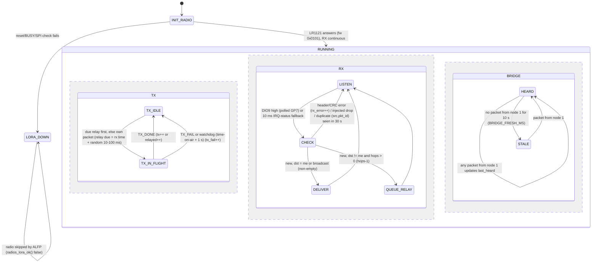

# Report changes to paste into the shared documents (2026-11-19)

The Week 6 Design Review (Google Doc owned by Maryam) and CSC09_PostTri1.docx (Shreya) live on
the team's Google Drive, not in this repo, so they were **not edited directly**. Each block below
is the replacement text, written against the code on branch `curveball-verify`. Evidence for
every number is in [RESULTS.md](RESULTS.md).

---

## 1. Week 6, section 6.1 (WiFi mesh statechart), "Bridge region" sentence

Replace:

> node A's heartbeat every 3 s keeps BRIDGE_REACHABLE; 6 s of silence → BRIDGE_LOST and
> WIFI_BRIDGE_OK is cleared, so the next transfer uses LoRa.

with:

> node A's heartbeat every 3 s keeps BRIDGE_REACHABLE; **10 s** of silence (BRIDGE_FRESH_MS =
> 10000 in main.c / main_smp.c, the same value as NFR6) → BRIDGE_LOST, so the next transfer uses
> LoRa. A transfer already under way keeps its radio. On hardware the longest gap node 2 saw
> between bridge heartbeats in a 60 min soak was 2.5 s, well inside 10 s.

Also redraw the BRIDGE_LOST transition label in the 6.1 diagram as `after(10 s) no heartbeat`.

---

## 2. Week 6, new section 6.4: LoRa mesh statechart (Mridula to check)

Source: `third_party/lora_mesh/lora/lora_mesh.c`, `lora_radio.c`, `lora_mesh.h`.

| Field | Entry |
| --- | --- |
| Subsystem | LoRa flooding mesh (LR1121, 924.2 MHz, SF7/BW125/CR4/5, 14 dBm) |
| Owner | Mridula |
| Runs in | comms task, every comms-loop pass (`lora_mesh_poll()`), core 0 on the SMP build |
| Purpose | Best-effort flooding of ALFP packets and the bridge heartbeat over LoRa; no ACKs or retries (ALFP does that end to end) |
| Reason a statechart is needed | Like 6.1, three behaviours run at once (one transmission at a time, receive/relay, bridge tracking), plus start-up failure; the radio also has its own TX watchdog |

Notes for the text box:
- No listen-before-talk: two nodes can start transmitting together; the 10-100 ms random relay
  delay only spreads relays out. Every node relays every new LoRa packet (no neighbour filter on
  LoRa, unlike WiFi), so airtime grows with the number of nodes.
- Node 1 sends an empty broadcast heartbeat every 3 s (`lora_mesh_set_heartbeat`).
- Queues: own TX 8, relay 8, RX 8 packets; dedup table 128 entries for 30 s; hop limit 4.
- Evidence: 60 min two-node soak, 0 LoRa telemetry failures; see RESULTS.md.

---

## 3. Week 6: fault table (new, after section 6)

| Fault | Detected by | Response | Visible as |
| --- | --- | --- | --- |
| microSD will not mount | `storage_fatfs_mount()` at boot | retry every 2 s, nothing else starts (SD_FAULT) | `sd: mount failed ..., retrying` |
| Neither radio starts | `radios_init()` | DEGRADED: captures queue on SD | `radios: NEITHER radio started` |
| LoRa module missing/dead | LR1121 init check | LoRa skipped; WiFi only | `s`: `lora DOWN` |
| ESP-01 missing / no WHOAMI | WST init, 2 s retry | WiFi skipped; images fall back to LoRa (size rule reason `fallback`) | `s`: `wifi DOWN`; `tx ... reason=fallback` |
| Bridge not heard for 10 s on a radio | `last_heard` vs BRIDGE_FRESH_MS | that radio not chosen; if neither, job waits in outbox | `s`: `bridge last heard ... ms ago` |
| Packet corrupted on air | radio CRC (LoRa) / CRC-8 (WiFi) / ALFP CRC-16 | packet dropped; ALFP NACKs the missing fragment | `rxerr`, `badcrc` |
| Reassembled file wrong | CRC-32 over the file on the bridge's SD | whole-file retry (status CRC fail) | `crcfail` |
| Transfer gives up (30/40 polls or 40 rounds) | ALFP sender | job stays in outbox, retried with backoff | `tx ...: gave_up` |
| Sender vanishes mid-transfer | bridge `rx_expiry` (60 s LoRa / 15 s WiFi) | session freed, `.part` deleted | `expired` |
| Bridge rebooted mid-transfer | bridge start-up | every stale `rx/*.part` deleted (F9) | `alfp: removed N stale .part file(s)` |
| Received name already used (16-bit session id repeats) | `rcv/<xx>/` lookup | first free `_1`.. `_99` suffix, never overwrites (F3) | file name |
| Outbox full (64 jobs) | `alfp_outbox_add` | oldest job dropped, logged and counted (F2) | `outbox: FULL ... dropped`; `s`: `outbox dropped (full)` |
| Capture queue full (4) | `app_request_capture` | request refused, counted | `[ALERT] capture queue full`; `s`: `capture q full` |
| No sample image for the sound label | `sip_pick` | label → group → `img` → any group; if the card has none, telemetry still sent (F6) | `capture ...: ... telemetry only` |
| DHT22 read fails | checksum / timeout | reading kept as unknown, counted | `s`: `dht22 ... fail N` |
| Audio samples lost | DMA ring overrun counter | capture still classified, loss reported | `[SOUND] ... lost=N` |
| Laptop stops reading USB | usb_owner 500 ms wait per line | line dropped and counted; other tasks never block | `s`: `usb dropped` |
| Log ring full | `log_putc` | line dropped and counted | `s`: `log dropped` |
| Uplink queue full (8 files) | `uplink_queue_add` | that file streamed inline (old behaviour) | `uplink: queue full`; `s`: `inline` |
| Kernel message-buffer error other than "full" | `rtos_msgq_*` (F8) | counted with last error code | `s`: `msgq errors N (last E)` |

---

## 4. Week 6, RTOS task table: replace the 6-task proposal + "built" note

Keep the old table only as "Week 6 proposal (superseded)" if the marking needs it. The built
firmware has these tasks:

**Dual-core build (uT-Kernel 3 SMP, the demo firmware, `uf2/csc09_smp_node_N.uf2`)**

| Task | Core | Priority (kernel, lower = higher) | Stack | Owns / does | Period / trigger |
| --- | --- | --- | --- | --- | --- |
| comms | 0 | 10 | 8192 B (≥ 5 152 B free on hardware) | both radios, microSD, ALFP send/receive, outbox, capture handling; bridge: uplink to laptop a few lines per pass | loop, 2 ms delay per pass (≈3 ms with the kernel's +1 tick) |
| usb_owner | 0 | 20 | 3072 B (2 192 B free) | the only writer to USB: drains the log ring; reads console keys | 10 ms |
| sensors | 1 (alone) | 10 | 8192 B (7 392 B free) | PIR, sound trigger, mic ADC/DMA + classifier, DHT22 (interrupts masked on core 1 for the ~5 ms bit read), light, button | 10 ms poll, DHT22/light every 2.1 s |

Core and priority above are what the kernel reports at run time (`s` now asks the kernel,
defect B.1), not constants.

**Single-core build (FreeRTOS, `uf2/csc09_node_N.uf2`, fallback)**: comms (prio 3, 2048 words),
sensors (prio 2, 1024 words, priority boost to 5 during the DHT22 read), console (prio 1, 512 words).

---

## 5. Week 6, section 3 priority text and Q&A rows (DHT22)

Replace "the sensors task briefly jumps to priority 5 during each ~5 ms DHT22 bit-bang read so
comms cannot preempt it mid-timing" with:

> Dual-core build: the sensors task runs alone on core 1, so the agreed Post-Tri1 change is done:
> interrupts on core 1 are masked for the ~5 ms bit-timing part of each DHT22 read only (not the
> 20 ms start pulse); radio and USB interrupts and the kernel tick all run on core 0, so nothing
> else is delayed. The bit loop runs from RAM so core 0's flash traffic cannot stretch it.
> Single-core FreeRTOS build: keeps the priority boost, because masking interrupts for 5 ms on the
> only core would overflow the ESP-01 UART FIFO (≈2.8 ms at 115200 baud). Result: 0 DHT22 failures
> in the soak (see RESULTS.md).

---

## 6. Week 6, section 8.1 (AI evidence), Maryam's row and the note above it

The note "Mridula's, Rhaylene's and Maryam's rows are personal ... left as placeholders" is out of
date for Mridula's row (filled) and wrong if it is read as "all filled": Maryam's row still has two
bracketed placeholders. Suggested note:

> Shreya's and Mridula's rows are complete. Maryam's row still has one item for Maryam to confirm
> (marked).

In Maryam's row, the second placeholder is a factual question and can be fixed from the code:

> ~~as a compact [JSON / key=value] string in the ALFP file header~~ → **as a compact 27-byte binary
> record (`common/capture_meta.h`: version, node, capture id, uptime, trigger flags, temperature ×10,
> humidity ×10, raw light, weather label + confidence, trigger trust (unused), sound class +
> confidence, sound RMS and zero-crossing rate, image index) in the ALFP manifest's metadata field**,
> not raw ADC values and not JSON.

The first placeholder, "[then on real node readings – keep only if true]", is about what Maryam
did and only Maryam can confirm or delete it.

---

## 7. Post-Tri1: bridge concurrency

Replace "the bridge handles one capture at a time" with:

> The bridge receives up to **4 transfers at once** (ALFP_RX_SESSIONS = 4, one per sender), each
> with its own `.part` file and missing-fragment list, so 4 field nodes can each be mid-transfer.
> Finished files are queued (up to 8) and streamed to the laptop a few lines per comms pass, so
> receiving never stops while a file goes up the USB link. Each **sender** still sends one
> transfer at a time.

---

## 8. Post-Tri1 / Week 6: DHT22 decision

Mark the "replace the priority boost with interrupt masking" action as **Done for the dual-core
build; deliberately not done for the single-core FreeRTOS fallback (reason in item 5)**.
